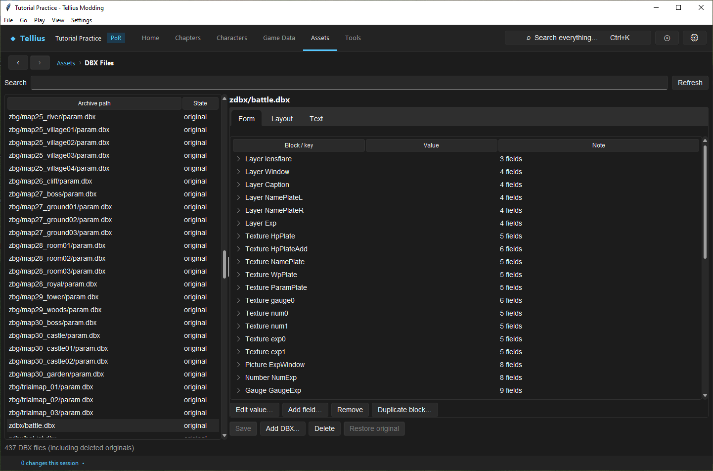
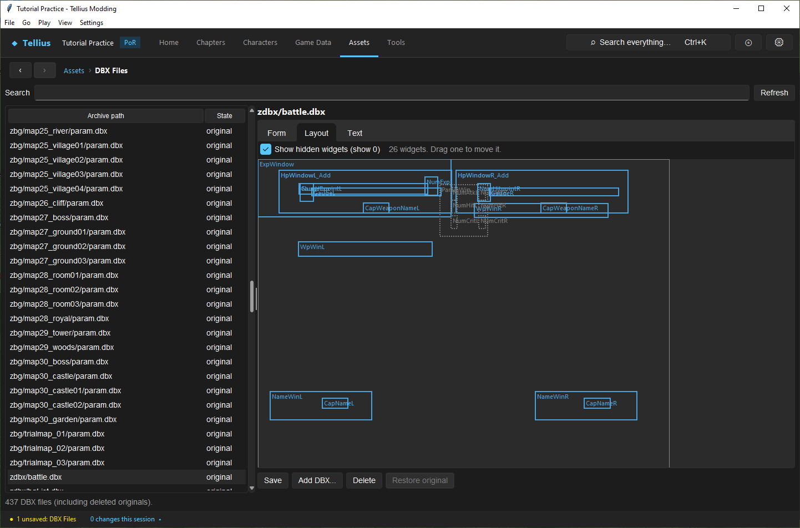

# Edit DBX files and the battle HUD

**Route:** Assets → DBX Files

## What you will make

You will open the file that lays out the battle screen, read its blocks with their English notes, move the left weapon window 60 pixels down on the layout view, see exactly what text that changes, and decide whether to save it. At the end you can edit any table of the battle archive safely, including the ones the specialised pages do not cover.

## Before you begin

- Prefer the specialised pages when they exist: weapons, sceneries and unit parameters ([Edit battle presentation](55-battle-presentation.md)) and cameras ([Edit battle cameras](70-battle-cameras.md)). This page edits the same files as text.
- Keep the [Simulate and render a fight](56-battle-simulator.md) fixture to look at the battle screen afterwards.

## How the editor fits together

`zdbx.cmp` holds 437 small text tables (`.dbx`). Each is a list of blocks in braces; each block has a `class`, a `name` and `key value` lines. The battle engine reads them: weapons (`xwp/`), sceneries (`zbg/`), unit parameters (`zu/`), cameras (`xcam/`, `zdbx/camera.dbx`), the job, class, weapon and effect lists (`zdbx/*List.dbx`), the skill table and the battle screen (`zdbx/battle.dbx`).

The page shows one file at a time in three views of the same text:

- **Form**: each block with its fields and an English note for every known key;
- **Layout**: every block with a `pos` drawn on the 640 × 480 screen, to drag (only for files that have such blocks: `zdbx/battle.dbx`, `zdbx/lensflare.dbx`);
- **Text**: the file itself.

Edits in any view change the text; **Save** writes it into `zdbx.cmp`. The first write of a file keeps the original for **Restore original**.

## Guided walkthrough

### 1. Open the battle screen

<!-- screenshot 71-a-setup.png -->
<figure class="tutorial-figure" markdown="1">

<figcaption markdown="span">**Assets › DBX Files** with `zdbx/battle.dbx`, the battle screen: **Form** lists each block (layers, textures, pictures, numbers, gauges) with its fields and an English note per known key.</figcaption>
</figure>

Open **Assets → DBX Files**, type `battle.dbx` in **Search** and select `zdbx/battle.dbx`. **Form** lists its blocks: the layers (`Layer Window`, `Layer Caption`, `Layer NamePlateL`…), the textures cut from `ztex/btlwin` and `ztex/number`, then the pictures, numbers and gauges that use them. Open `Picture WpWinL`: `layer Window`, `show 1`, `pos 63,69`, `texName WpPlate`. **Note** explains each key.

### 2. Move a window

<!-- screenshot 71-b-result.png -->
<figure class="tutorial-figure" markdown="1">

<figcaption markdown="span">The **Layout** tab draws every widget with a position on the 640 × 480 screen; `WpWinL`, the left weapon window, was dragged down. The text changed (**Save** is enabled), but nothing is written until **Save**.</figcaption>
</figure>

1. Open **Layout**. The 26 widgets with a position are drawn as rectangles at their size (taken from their texture's cell size); dashed grey ones are hidden (`show 0` or empty), shown while **Show hidden widgets (show 0)** is ticked.
2. Drag `WpWinL`, the left weapon window, 60 pixels down.

Its `pos` becomes `63,129`. **Save** is enabled and the status bar counts *1 unsaved: DBX Files*. Open **Text** to see the changed line; nothing else in the file moved.

3. Press **Save**, render the fixture to see the weapon window lower on the battle screen, then press **Restore original** (or, before saving, select another file and answer **No** to discard).

## Understand every control

| Control | What it does |
| --- | --- |
| **Search** / **Refresh** | Filter the file list; reread `zdbx.cmp` (asks to save first when the text has unsaved changes). |
| File list | **Archive path** and **State**: original, edited, added, or deleted (a retail file removed by the project, kept in the list to restore it). |
| **Form** tab | **Block / key**, **Value**, **Note**. **Edit value…** changes the selected field, **Add field…** adds a key to the selected block, **Remove** removes a field or block, **Duplicate block…** copies a block under a new name. |
| **Layout** tab | Drag a widget to move it; **Show hidden widgets (show 0)** draws hidden ones dashed. Selecting a widget selects its block in **Form**. Read-only for a deleted file. |
| **Text** tab | The raw file, with undo. |
| **Save** | Writes the text into `zdbx.cmp` as it is. It refuses only characters Shift-JIS cannot hold; it does not check the braces and keys, so look at **Form** before saving a hand edit. |
| **Add DBX…** | Asks for a new archive path (`xcam/new_script.dbx`), refuses one that exists, then lets you type its text; **Save** adds it. |
| **Delete** | Removes the file from the archive after asking (a retail file stays listed as deleted and can be restored). |
| **Restore original** | Puts back the retail text of an edited or deleted file, or removes an added one. |

## Things to try next

1. **A hidden number.** In **Layout**, find the dashed `NumAtk`/`NumHit`/`NumCrit` widgets of the vanilla screen; they are hidden because the digit texture they need is missing ([Apply engine tweaks](57-game-code.md) has working battle-number patches).
2. **A new block.** **Duplicate block…** on a `Picture` and move the copy, to add a second frame.
3. **A list.** Read `zdbx/bgList.dbx` to see why a new scenery must be listed before maps can use it.

## Interactions and precedence

- The specialised pages and this one write the same files. Save here before switching to a specialised page, and the other way round.
- Each block's `layer` decides which layer it is drawn with; a layer with `show` empty hides all its widgets.
- Sizes come from the texture cell named by `texName`; a widget with no texture is drawn 40 × 16.
- Keys the engine does not know are ignored by the game; the **Note** column says which keys are known.

## Test matrix

| Case | Setup | Expected result |
| --- | --- | --- |
| Baseline | `zdbx/battle.dbx` opened | 26 widgets; **Save** disabled |
| Intended change | `WpWinL` dragged 60 pixels down | `pos 63,129`; **Save** enabled |
| Boundary | Select another file without saving | Asks to save, discard or cancel |
| Likely failure | A brace removed in **Text** | **Form** no longer shows the blocks after it; **Save** would still write it, so restore the brace first |

## Troubleshooting

| Symptom | Likely cause | What to do |
| --- | --- | --- |
| **Layout** is greyed | The file has fewer than two positioned widgets | Use **Form** or **Text** |
| A widget is in place on the layout but not in game | Its layer is hidden, or the engine draws it relative to another element | Check its `layer` and the layer's `show` |
| A specialised page shows old values | It read the archive before your save here | Switch away and back, or **Refresh** |

## Save, build, and revert

Nothing is written until **Save**; the status bar lists unsaved DBX text. **Restore original** reverts one file. Build the disc to test in game.

## Limits and confidence

- The DBX reader and writer keep every untouched byte, and the three views are source-reviewed; the move in this lesson was done in the app (app-tested).
- The notes cover the known keys; some list tables and their consumers are not fully understood.
- The Layout view draws positions only: animation, scaling and the engine's relative placement are not shown.

## Related tutorials and references

- Before: [Edit battle presentation](55-battle-presentation.md), [Edit battle cameras](70-battle-cameras.md)
- Next: [Simulate and render a fight](56-battle-simulator.md)
- Reference: [ZDBX & DBX](../formats/zdbx.md), [Battle Staging & Camera](../systems/battle-staging.md)

---

[← Previous: Edit battle cameras](70-battle-cameras.md) · [All tutorials](index.md)
