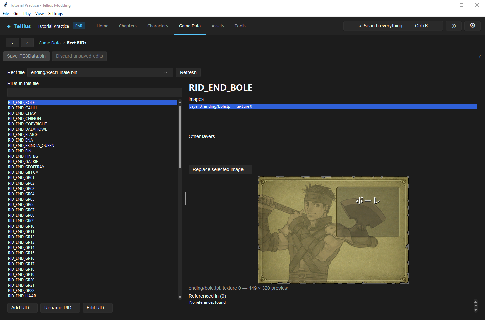
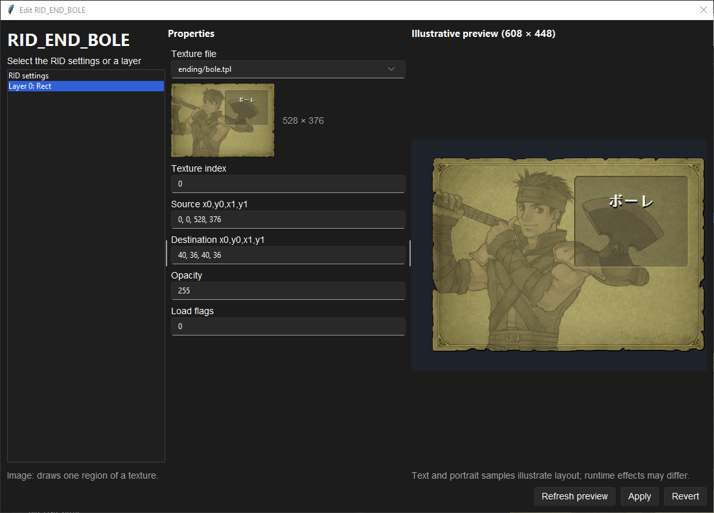

# Lay out screens with Rect RIDs

**Route:** Game Data → **Rect RIDs**

## What you will make

You will read how one screen picture, Boyd's epilogue card `RID_END_BOLE`, is put together: which texture region it draws, where on the screen, at which depth, and with which timing. Then you will see how to add a RID from your own pictures and where to check what uses it. At the end you can read any rect resource and you know which of its fields are safe to change.

## Before you begin

- [Create and display dialogue backgrounds](38-backgrounds.md): backgrounds are the most common RIDs.
- Pictures of your own for step 3 (PNG), and a copy of the project folder.
- Save or revert the other editors first: the page refuses to change a rect file while another editor has unsaved changes.

## How the editor fits together

A **rect file** (`s/rect.bin`, `ending/RectFinale.bin`, `window/rectdesc.bin`…) is a list of named resources, the **RIDs** (`RID_…`). Scripts and data show a picture by its RID: `RectBuild("RID_…")` in an event, a chapter record's **Base background** and **Talk background**, the Sound Room slideshow ([Edit the Sound Room, credits and in-game tutorials](73-sound-room-credits-tutorials.md)).

A RID has settings shared by all its layers, then one or more layers:

| Part | Fields | What they decide |
| --- | --- | --- |
| **RID settings** | **Composition mode** (0 stack, 1 frames, 2 fade), **Draw depth**, **Animation period (seconds)**, **Brightness** (0 = default), **Ambient effect** (0 none, 1 snow, 2 altar, 3 sand, 4 mist) | How the layers combine and animate, and the effect drawn over them |
| An image layer (*Rect*) | **Texture file**, **Texture index**, **Source x0,y0,x1,y1**, **Destination x0,y0,x1,y1**, **Opacity**, **Load flags** | Which region of which texture is drawn where on the 608 × 448 screen |
| Other layers | Text, portrait seats and other kinds; fields shown when decoded | Shown under **Other layers**; undecoded bytes are kept as they are |

The page edits a rect file only when the app can rewrite it byte for byte; otherwise it says *This file cannot be rewritten byte-for-byte; editing is disabled.*

## Guided walkthrough

### 1. Read a RID

<!-- screenshot 72-a-setup.png -->
<figure class="tutorial-figure" markdown="1">

<figcaption markdown="span">**Game Data › Rect RIDs**: the RIDs of a rect file, the layers of the selected RID, its properties and preview, and where it is **Referenced in**.</figcaption>
</figure>

1. Open **Game Data › Rect RIDs**. Pick **Rect file** `ending/RectFinale.bin`: the status line counts its RIDs.
2. Type `BOLE` in the box under **RIDs in this file** and select `RID_END_BOLE`.
3. On the right: **Images** *Layer 0: ending/bole.tpl · texture 0*, no **Other layers**, the preview, and *ending/bole.tpl, texture 0 — 449 × 320 preview*. **Referenced in (0)**: *No references found*: no file the app searches names `RID_END_BOLE` whole: the game builds the name from the character's PID when it shows the individual war record ([Edit the ending and the war record](79-ending-and-war-record.md)).

### 2. Read its properties

<!-- screenshot 72-c-edit.png -->
<figure class="tutorial-figure" markdown="1">

<figcaption markdown="span">**Edit RID…** on `RID_END_BOLE`, Boyd's epilogue picture: **RID settings** and its one layer on the left, *Layer 0: Rect* selected and its **Properties** in the middle, the **Illustrative preview (608 × 448)** on the right. **Apply** saves the rect file; **Revert** drops the edits.</figcaption>
</figure>

1. Press **Edit RID…**. Select **RID settings**: **Composition mode** 0, **Draw depth** 90, **Animation period (seconds)** 0.0, **Brightness** 0, **Ambient effect** 0.
2. Select *Layer 0: Rect* (*Image: draws one region of a texture.*): **Texture file** `ending/bole.tpl` (528 × 376), **Texture index** 0, **Source x0,y0,x1,y1** `0, 0, 528, 376`, **Destination x0,y0,x1,y1** `40, 36, 40, 36`, **Opacity** 255, **Load flags** 0.
3. Change **Opacity** to 128 and press **Refresh preview**: the card is half transparent in the **Illustrative preview (608 × 448)**. Press **Revert**, then close.

### 3. Add a RID

1. Select the rect file the screen reads (for a conversation background, `s/rect.bin`), press **Add RID…**, choose your pictures (*Choose images for the new RID*), and type the name (*New RID:*, `RID_TUTORIAL_CAMP`).
2. The app writes the textures and the RID and selects it. Read its layers and properties as in step 2.
3. Use it: `RectBuild("RID_TUTORIAL_CAMP")` in a script, or the chapter's **Talk background** on **Chapter data**. **Referenced in** then lists that user.

**Rename RID…** changes the name in the rect file; its users must be changed too (read **Referenced in** first). **Replace selected image…** replaces the selected layer's picture, stretched to the texture's size.

## Understand every control

| Control | What it does |
| --- | --- |
| **Rect file** / **Refresh** | The rect file shown / read it again |
| **RIDs in this file** and its filter box | The RIDs; type to filter |
| **Add RID…** | A new RID from your pictures, one image layer each |
| **Rename RID…** | A new name for the selected RID |
| **Edit RID…** | The properties dialog (below) |
| **Images** | The image layers: file and texture |
| **Other layers** | Non-image layers; double-click to edit one |
| **Replace selected image…** | New picture for the selected image layer |
| **Referenced in (N)** | Files that name the RID |
| Edit dialog: **RID settings** / layer list | What the **Properties** column shows |
| **Properties** | The decoded fields; *This layer has no decoded editable fields; its bytes are preserved.* otherwise |
| **Illustrative preview (608 × 448)** | The layers drawn with sample text and portraits; *runtime effects may differ* |
| **Refresh preview** / **Apply** / **Revert** | Redraw / save the rect file / drop the edits |

## Things to try next

1. **A slower fade.** Find a RID with **Composition mode** 2 and change its **Animation period (seconds)**.
2. **Snow.** Set **Ambient effect** 1 on a copy of a background RID and show it in a test scene.
3. **Find a background's users.** Select a RID of `s/rect.bin` and read **Referenced in**: the chapters and scripts that show it.

## Interactions and precedence

- `s/rect.bin` and `window/rectdesc.bin` are also inside `system.cmp`; the build copies the loose files in ([Set up Dolphin and build the game](04-dolphin-setup.md)).
- A RID is found by name: a renamed RID breaks every user that still names the old one.
- A RID named only at run time (from pieces) is not in **Referenced in**.
- Textures are shared: two RIDs can draw regions of one texture file, and replacing it changes both.

## Test matrix

| Case | Setup | Expected result |
| --- | --- | --- |
| Baseline | `RID_END_BOLE` | One image layer, 528 × 376 texture, destination 40, 36 |
| Intended change | **Opacity** 128, **Refresh preview** | Half-transparent card in the preview |
| Boundary | **Revert** | Back to 255; file unchanged |
| New RID | **Add RID…** `RID_TUTORIAL_CAMP` | Listed in the file; **Referenced in (0)** until used |
| In game | A scene showing the new RID | The picture at its destination (Dolphin) |

## Troubleshooting

| Symptom | Likely cause | What to do |
| --- | --- | --- |
| The buttons are disabled | The file cannot be rewritten byte for byte | Use another rect file, or edit by hand |
| *Save or revert the other open editors…* | Unsaved edits elsewhere | Save or revert them |
| The picture is blank in game | The script names a RID of another rect file than the one that screen reads | Add the RID to the right file |
| The preview differs from the game | The preview is illustrative | Test in Dolphin |

## Save, build, and revert

**Add RID…**, **Rename RID…**, **Replace selected image…** and **Apply** write at once. Build to test. To undo, restore the rect file and its textures to the originals or copy back your project copy.

## Limits and confidence

- The rect format, the decoded fields and the controls are source-reviewed; reading `RID_END_BOLE` and its properties was done in the app on a US disc (app-tested).
- The meaning of some layer kinds and load flags is not decoded; the in-game result of an edit is not checked here (unknown).

## Related tutorials and references

- Before: [Create and display dialogue backgrounds](38-backgrounds.md)
- Also: [Edit the Sound Room, credits and in-game tutorials](73-sound-room-credits-tutorials.md), [Find where a record is used](68-find-references.md)

---

[← Previous: Add and show a background](38-backgrounds.md) · [All tutorials](index.md) · [Next: Use inline codes and Tellius fonts →](39-inline-text-and-fonts.md)
