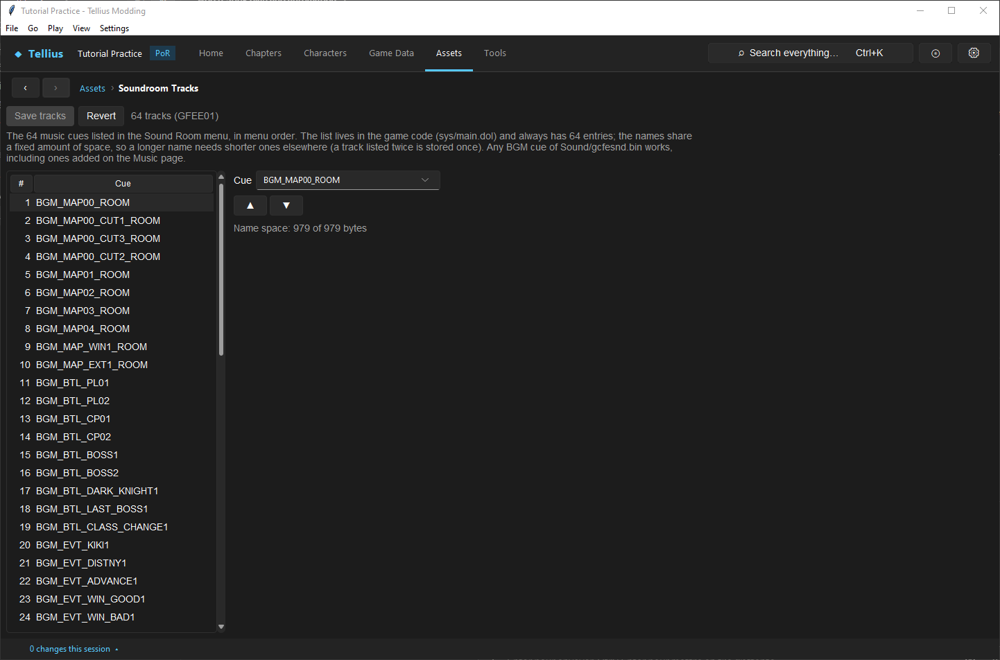
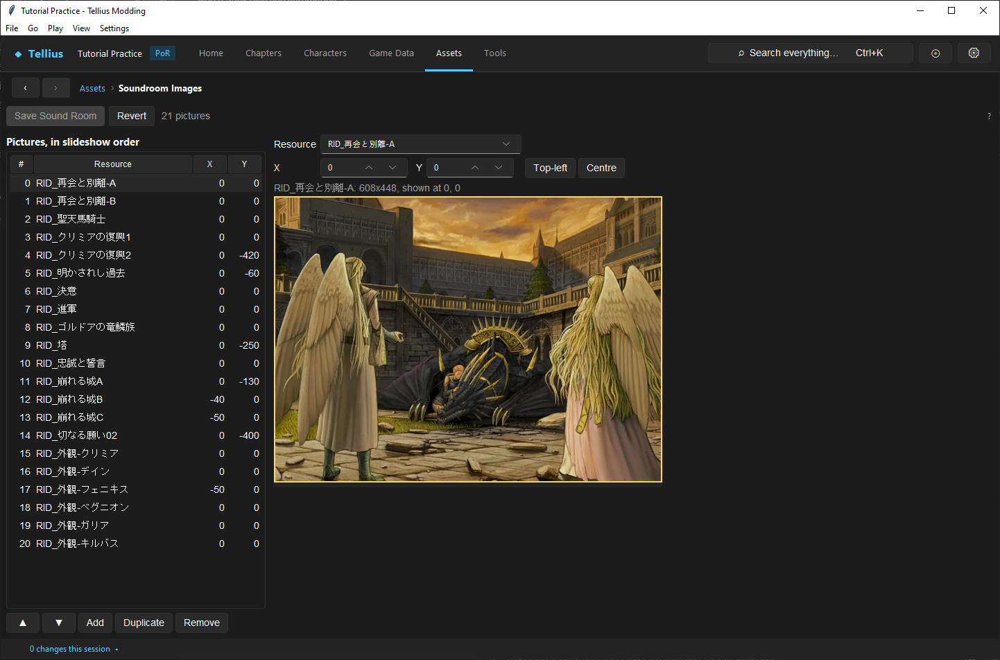
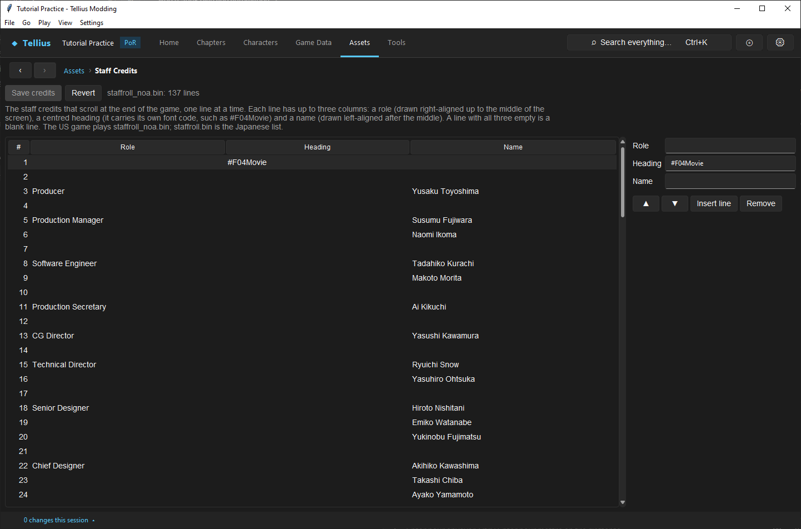
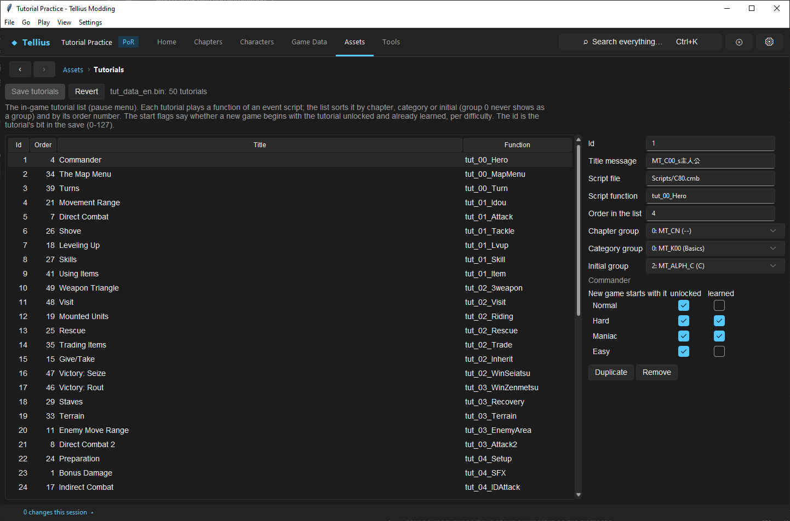

# Edit the Sound Room, credits and in-game tutorials

**Route:** Assets → **Soundroom Tracks**, **Soundroom Images**, **Staff Credits**, **Tutorials**

## What you will make

You will put a new music cue in the Sound Room's track list, read the slideshow behind it, add a credits line for your mod, and look at how an in-game tutorial is unlocked. At the end you know the four files these screens edit, their fixed sizes, and which change needs a new game to show.

## Before you begin

- A music cue to list, such as `BGM_TUTORIAL_THEME` from [Replace or add music](47-music.md); any retail `BGM_` cue works too.
- For new slideshow pictures: a background made in [Create and display dialogue backgrounds](38-backgrounds.md).
- A copy of the project folder.

## How the editor fits together

| Screen | File | Size | Saved by |
| --- | --- | --- | --- |
| **Soundroom Tracks**: the music cues of Extras › Sound Room, in menu order | a table in `sys/main.dol` | always 64 entries; the names share 979 bytes | **Save tracks** |
| **Soundroom Images**: the pictures shown behind the menu, as a slideshow | `soundroom.bin` | a list of `RID_` resources with an X/Y offset | **Save Sound Room** |
| **Staff Credits**: the lines that scroll after the ending | `ending/staffroll_noa.bin` (the US game plays the NOA list; `staffroll.bin` is the Japanese one) | one line every 48 units, three columns | **Save credits** |
| **Tutorials**: the pause menu's tutorial list | `tut_data_en.bin` (US) | up to 128 ids, the tutorial's bit in the save | **Save tutorials** |

The Sound Room plays cues by name, like chapters do: any cue of `Sound/gcfesnd.bin` works, including ones you added. A cue that is listed in a chapter but not in the 64 entries never appears in the Sound Room.

A tutorial is a row: its title message, the script function that plays it (in `Scripts/C80.cmb`), the group it falls under in each of the list's three sort modes (chapter, category, initial), its order, and two flags per difficulty: whether a new game starts with it **unlocked** (listed) and **learned** (already read). Chapter scripts unlock tutorials as the story goes (`TutorialUnlock(10)` in Ch.1).

## Guided walkthrough

### 1. List a track in the Sound Room

<!-- screenshot 73-tracks.png -->
<figure class="tutorial-figure" markdown="1">

<figcaption markdown="span">**Assets › Soundroom Tracks**: the Sound Room's 64 music cues, a table in `main.dol`. Pick and reorder them, then **Save tracks**.</figcaption>
</figure>

1. Open **Assets › Soundroom Tracks**: *64 tracks (GFEE01)*, then the list, starting with `BGM_MAP00_ROOM`.
2. Select entry 64 (the last), and in **Cue** pick your cue, `BGM_TUTORIAL_THEME`.
3. Read **Name space**: *979 of 979 bytes* on the retail list. A longer name than the one it replaces needs room: if the line turns yellow, shorten another entry or list a cue twice (a name listed twice is stored once).
4. Use **▲** / **▼** to move it, then **Save tracks**. It writes `main.dol` at once, like **Game Code**.

### 2. Read the slideshow

<!-- screenshot 73-sound-room.png -->
<figure class="tutorial-figure" markdown="1">

<figcaption markdown="span">**Assets › Soundroom Images**: the Sound Room slideshow pictures, in order, with their offsets.</figcaption>
</figure>

Open **Assets › Soundroom Images**: *21 pictures*. **Pictures, in slideshow order** lists each picture's **Resource** and its **X**, **Y** offset. Select `RID_再会と別離-A`: the preview draws it on the 608 × 448 screen (*608x448, shown at 0, 0*). Drag it in the preview, or use **Top-left** and **Centre**, to move it. **Add**, **Duplicate**, **Remove** and **▲** / **▼** edit the list; **Save Sound Room** writes it.

### 3. Credit your mod

<!-- screenshot 73-staff-credits.png -->
<figure class="tutorial-figure" markdown="1">

<figcaption markdown="span">**Assets › Staff Credits**: the end credits lines in three columns; edit, add and reorder, then **Save credits**.</figcaption>
</figure>

1. Open **Assets › Staff Credits**: *staffroll_noa.bin: 137 lines*. Each line has a **Role** (drawn right-aligned to the middle), a **Heading** (centred, with its own font code such as `#F04Movie`) and a **Name** (left-aligned after the middle). A line with all three empty is a blank line.
2. Select line 2 (blank) and press **Insert line**. In the new line, set **Role** `Tutorial mod` and **Name** your name; insert a blank line after it.
3. Press **Save credits**. Watch the ending in Dolphin: one more line scrolls.

### 4. Read a tutorial entry

<!-- screenshot 73-a-setup.png -->
<figure class="tutorial-figure" markdown="1">

<figcaption markdown="span">**Assets › Tutorials**: the in-game tutorial list, its groups and order, and the flags that unlock each entry (**New game starts with it**).</figcaption>
</figure>

Open **Assets › Tutorials**: *tut_data_en.bin: 50 tutorials*. Select id 1, *Commander*: **Title message** `MT_C00_s主人公`, **Script file** `Scripts/C80.cmb`, **Script function** `tut_00_Hero`, **Order in the list** 4, the three groups, and **New game starts with it**: **unlocked** on every difficulty, **learned** on Hard and Maniac. A player on Hard already has it marked as read.

To add one: **Duplicate** a similar entry, give it a free **Id**, its own title message and script function (written in `C80.cmb`), an **Order in the list**, and unlock it from a chapter script with `TutorialUnlock(<id>)`. **Save tutorials**.

## Understand every control

### Soundroom Tracks

| Control | What it does |
| --- | --- |
| List | The 64 entries, numbered as the menu shows them |
| **Cue** | The entry's `BGM_` cue |
| **▲** / **▼** | Move the entry |
| **Name space** | Bytes used of the table's fixed room; yellow when over |
| **Save tracks** / **Revert** | Write `main.dol` / reload it |

### Soundroom Images

| Control | What it does |
| --- | --- |
| **Pictures, in slideshow order** | **Resource**, **X**, **Y** per picture |
| **Resource** | An `s/rect.bin` resource (`RID_`); *no such s/rect.bin resource* when it does not exist |
| **X** / **Y**, **Top-left**, **Centre**, drag in the preview | The offset on the 608 × 448 screen |
| **▲** **▼** **Add** **Duplicate** **Remove** | Edit the list |
| **Save Sound Room** / **Revert** | Write / reload `soundroom.bin` |

### Staff Credits

| Control | What it does |
| --- | --- |
| **#**, **Role**, **Heading**, **Name** | The lines; edit the selected one in the fields on the right |
| **▲** **▼** **Insert line** **Remove** | Edit the list |
| **Save credits** / **Revert** | Write / reload the file |

### Tutorials

| Control | What it does |
| --- | --- |
| **Id**, **Order**, **Title**, **Function** | The list |
| **Id** | The tutorial's bit in the save, 0–127 |
| **Title message**, **Script file**, **Script function** | What is shown and what plays |
| **Order in the list** | Sort position |
| **Chapter group**, **Category group**, **Initial group** | Where it is listed in each sort mode (group 0 never shows as a group) |
| **New game starts with it** **unlocked** / **learned** × Normal, Hard, Maniac, Easy | Its state in a new game, per difficulty |
| **Duplicate** / **Remove** | Add a copy / remove the entry |
| **Save tutorials** / **Revert** | Write / reload `tut_data_en.bin` |

## Things to try next

1. **A Sound Room for your campaign.** Replace entries 60–64 with your campaign's cues and check the menu order.
2. **A new slideshow picture.** Make a background in [Create and display dialogue backgrounds](38-backgrounds.md), **Add** it here and centre it.
3. **A tutorial learned on every difficulty.** Tick **learned** on Normal for *Commander* and start a new game: it shows as read.

## Interactions and precedence

- The Sound Room list and the Game Code page both write `main.dol`; each page reads it again when shown.
- A cue removed from `gcfesnd.bin` but still listed leaves a silent Sound Room entry.
- Tutorial start flags only apply to a new game; a save keeps its own unlocked and learned bits.
- Credits are shown only after the ending: test with a late save, or a chapter jump to the last chapter.

## Test matrix

| Case | Setup | Expected result |
| --- | --- | --- |
| Baseline | Unmodified project | 64 tracks, *979 of 979 bytes*; 21 pictures; 137 credit lines; 50 tutorials |
| Intended change | Entry 64 → `BGM_TUTORIAL_THEME`, saved | The Sound Room lists and plays it (Dolphin) |
| Boundary | A name longer than the room allows | **Name space** turns yellow; saving is refused |
| Credits | One line inserted, saved | 138 lines; it scrolls after the ending (Dolphin) |
| Tutorials | **learned** ticked on Normal | A new Normal game shows it as read (Dolphin) |

## Troubleshooting

| Symptom | Likely cause | What to do |
| --- | --- | --- |
| A Sound Room entry is silent | The cue does not exist in `gcfesnd.bin` | Pick a cue listed on the Music page |
| **Save tracks** refused | Over the name room | Shorten or repeat names |
| A slideshow picture is missing | Its `RID_` is not in `s/rect.bin` | Make it on Backgrounds, or pick another |
| Credits overlap | A line needs more width | Split it into two lines |
| A new tutorial never appears | No script unlocks it, and it is not unlocked at start | Add `TutorialUnlock(<id>)` or tick **unlocked** |

## Save, build, and revert

Each page has its own save and **Revert**. **Save tracks** writes `main.dol` at once; the others write their file. Build to test; restore a file from `originals/` or your project copy to undo.

## Limits and confidence

- The four formats, their sizes and the controls are source-reviewed; the pages and values in this lesson were read in the app on a US disc (app-tested). The edits are described, not saved, in the captures.
- The in-game result of each edit needs Dolphin (unknown here).

## Related tutorials and references

- Before: [Replace or add music](47-music.md), [Replace 2D graphics](50-graphics.md)
- Also: [Create and display dialogue backgrounds](38-backgrounds.md), [Apply engine tweaks](57-game-code.md)

---

[← Previous: Replace 2D graphics](50-graphics.md) · [All tutorials](index.md) · [Next: Round-trip a model through Blender →](51-blender-round-trip.md)
