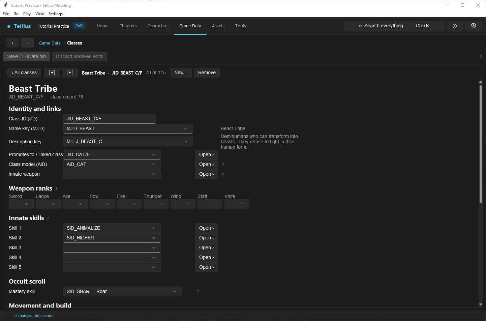
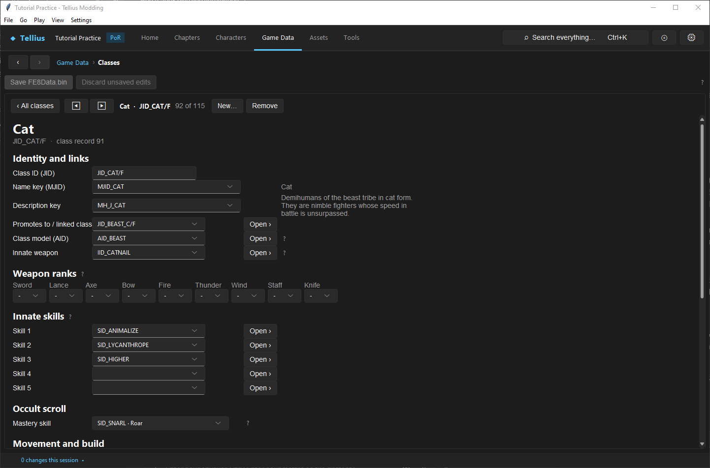
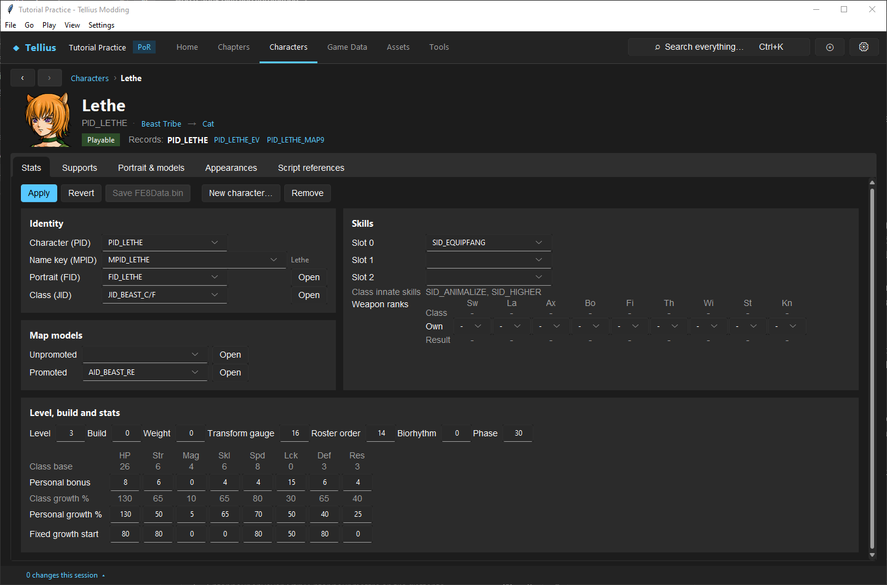

# Make a laguz unit

**Route:** Game Data → **Classes**; Characters → a character's **Stats**; a chapter's **Build**

## What you will make

You will read how Lethe works, then make a new cat laguz, `PID_TUTORIAL_CAT`, as a copy of her, choose when it first transforms, and place it in a chapter with its own starting gauge. At the end you know which record owns the human form, the beast form, the strike, the gauge and the starting value, and what a laguz class edit changes for every unit of that tribe.

## Before you begin

- [Create a character](10-create-character.md) and [Create, understand, and test a class](16-classes.md).
- A copy of the project folder.

## How the editor fits together

A laguz is one character with **two classes linked to each other**: the human form and the beast form. Transforming swaps the unit's class for the linked one; everything that comes from the class changes at once (stats, movement, skills, the strike), while level, EXP, HP and personal bonuses stay with the unit ([Laguz Transformation](../systems/laguz-transformation.md)).

| Piece | Where | Lethe |
| --- | --- | --- |
| Human form | Class record, **Promotes to / linked class** points to the beast form | `JID_BEAST_C/F` (*Beast Tribe*), linked to `JID_CAT/F`; skills `SID_ANIMALIZE`, `SID_HIGHER` |
| Beast form | Class record linked back to the human form; its **Innate weapon** is the strike; it adds `SID_LYCANTHROPE`, the transformed state | `JID_CAT/F` (*Cat*), strike `IID_CATNAIL` (*Claw*: fang, 8 might, 90 hit) |
| Starting gauge | Character **Transform gauge** (0–20) | 16 |
| Gauge in one chapter | Deployment **Laguz gauge** (1–19; 0 keeps the character's) | |
| Beast-form map model | Character **Map models › Promoted** (the linked form's slot) | `AID_BEAST_RE` |

The gauge runs from 0 to 20. In human form each action step adds 2 and taking damage adds 4; at 20 the unit transforms. In beast form each step subtracts 1 and damage subtracts 3; at 0 it changes back. A class with the always-transformed trait starts and stays at 20. Items: **Laguz Stone** (`IID_CHANGESTONE`) transforms the unit; **Demi Band** (`IID_CHANGERING`) halves the transformation bonus to Str, Mag, Skl, Spd, Def and Res; **Laguz Band** (`IID_CHANGERING2`) is a laguz stat ring ([Items and weapons](../systems/items-weapons.md)).

## Guided walkthrough

### 1. Read the two classes

<!-- screenshot 74-a-setup.png -->
<figure class="tutorial-figure" markdown="1">

<figcaption markdown="span">**Game Data › Classes**, `JID_BEAST_C/F` (*Beast Tribe*, Lethe's class in human form): **Promotes to / linked class** `JID_CAT/F`, the class the unit becomes when it transforms, and the innate skills `SID_ANIMALIZE` and `SID_HIGHER`. No innate weapon in this form.</figcaption>
</figure>

Open **Game Data › Classes**, `JID_BEAST_C/F`. **Promotes to / linked class** `JID_CAT/F`: for laguz this field is the other form, not a promotion. **Innate weapon** is empty: the human form fights with nothing.

<!-- screenshot 74-c-cat.png -->
<figure class="tutorial-figure" markdown="1">

<figcaption markdown="span">The linked class `JID_CAT/F` (*Cat*): it links back to `JID_BEAST_C/F`, its **Innate weapon** is `IID_CATNAIL` (*Claw*: fang, 8 might, 90 hit) and it adds `SID_LYCANTHROPE`, the transformed state. Its stats are the transformed unit's.</figcaption>
</figure>

Press **Open ›** on the linked class: `JID_CAT/F`, linked back to `JID_BEAST_C/F`, **Innate weapon** `IID_CATNAIL`, **Innate skills** `SID_ANIMALIZE`, `SID_LYCANTHROPE`, `SID_HIGHER`. Compare the two **Stats** blocks: the cat's are the transformed unit's bases and caps.

### 2. Read the character

<!-- screenshot 74-b-result.png -->
<figure class="tutorial-figure" markdown="1">

<figcaption markdown="span">Lethe's **Stats**: **Class (JID)** `JID_BEAST_C/F`, **Transform gauge** 16 (she starts four points from transforming) and the personal skill `SID_EQUIPFANG`.</figcaption>
</figure>

Open Lethe: **Class (JID)** `JID_BEAST_C/F` (the human form; the header shows *Beast Tribe → Cat*), **Transform gauge** 16, personal skill `SID_EQUIPFANG`, **Map models › Promoted** `AID_BEAST_RE`, the cat model she uses when transformed.

### 3. Make your own

1. **New character…**: **ID** `PID_TUTORIAL_CAT`, **Start as a copy of** `PID_LETHE`, **Create**. Give it its own name ([Create a character](10-create-character.md)).
2. **Transform gauge**: `10`, so it needs five action steps before its first transformation. **Apply**, **Save FE8Data.bin**.
3. Place it on Ch.1's **Build** as in lesson 10. In the unit panel, **Laguz gauge** shows for a laguz class: leave 0 to use the character's 10, or set `19` to start one step from transforming in that chapter only. **Apply**, **Save Chapter**.

Do not give a laguz an ordinary weapon in its deployment: when the game builds the unit, it clears the weapon slots and creates the strike from the beast class's **Innate weapon** in the first one. Items (slots 5–8), such as a Laguz Stone, are kept. **Laguz gauge** set on a unit that is not a laguz makes **Apply** warn that it will not be used.

### 4. Change the tribe (optional)

Editing `JID_CAT/F` changes every cat: Lethe, Ranulf's form if he uses it, and yours. For a laguz of its own, copy both classes with **New…** in Game Data › Classes, point each one's **Promotes to / linked class** at the other copy, and set your character's **Class (JID)** to the human copy ([Create, understand, and test a class](16-classes.md)).

## Understand every choice

| Choice | Effect | Owner |
| --- | --- | --- |
| **Promotes to / linked class** on both forms | Which class each form turns into | the two class records |
| **Innate weapon** of the beast form | The strike, created in slot 1 when the unit is built | beast class |
| `SID_LYCANTHROPE` in the beast form | Marks the transformed state | beast class |
| Always-transformed trait | Starts and stays transformed at 20 | class traits |
| **Transform gauge** (character) | Starting gauge of a new unit | character |
| **Laguz gauge** (deployment, 1–19) | Starting gauge in that chapter; 0 keeps the character's | deployment row |
| **Map models › Promoted** | The beast form's map model for this character | character |

## Things to try next

1. **A faster transformation.** Set **Transform gauge** 18 and count the steps in [Play and rewind a chapter in the app](58-play-chapter.md).
2. **A Laguz Stone.** Give the unit `IID_CHANGESTONE` in its deployment items and use it on turn 1.
3. **A stronger tribe.** Raise `JID_CAT/F`'s Strength base and compare Lethe in the **Battle Simulator** before and after.

## Interactions and precedence

- Scripted transformations (`UnitTransform`, `InstantUnitTransform`) set the gauge to 20 or 0, whatever it was.
- Saves keep both the class and the raw gauge, so a reloaded unit is in the form it was saved in.
- The difficulty's laguz growth row is used only by auto-levelling, never by a transformation.
- A missing beast-form model falls back to a dummy on the map and to map combat in battle.

## Test matrix

| Case | Setup | Expected result |
| --- | --- | --- |
| Baseline | Lethe | Gauge 16; transforms after two steps (Play or Dolphin) |
| Intended change | `PID_TUTORIAL_CAT`, gauge 10 | Transforms after five steps |
| Boundary | Deployment **Laguz gauge** 19 | Transforms after one step in that chapter only |
| Damage | Hit in human form | Gauge +4 |
| In game | Strike in beast form | `IID_CATNAIL` attacks; human form cannot attack (Dolphin) |

## Troubleshooting

| Symptom | Likely cause | What to do |
| --- | --- | --- |
| Never transforms | The class has no linked beast form, or the gauge cannot reach 20 | Check both classes' links |
| Transforms but cannot attack | The beast form has no **Innate weapon** | Set it |
| All cats changed | The shared class was edited | Copy both classes for a unique tribe |
| Wrong model in beast form | **Map models › Promoted** empty or wrong | Set the beast model's AID ([Give a character unique models](12-character-model-slot.md)) |

## Save, build, and revert

Classes and characters: **Save FE8Data.bin**. Deployment gauge: **Save Chapter**. Revert by restoring the fields, or your project copy.

## Limits and confidence

- The two-class model, the gauge rules and the fields are source-reviewed ([Laguz Transformation](../systems/laguz-transformation.md)); the classes and Lethe's record were read in the app on a US disc (app-tested).
- A new laguz unit was not played in Dolphin here (unknown).

## Related tutorials and references

- Before: [Create a character](10-create-character.md), [Create, understand, and test a class](16-classes.md)
- Reference: [Laguz Transformation](../systems/laguz-transformation.md), [Laguz Weapons](../systems/weapons-laguz.md)

---

[← Previous: Edit data in bulk outside the app](67-bulk-edit.md) · [All tutorials](index.md) · [Next: Tune staves and status effects →](75-staves-and-status.md)
