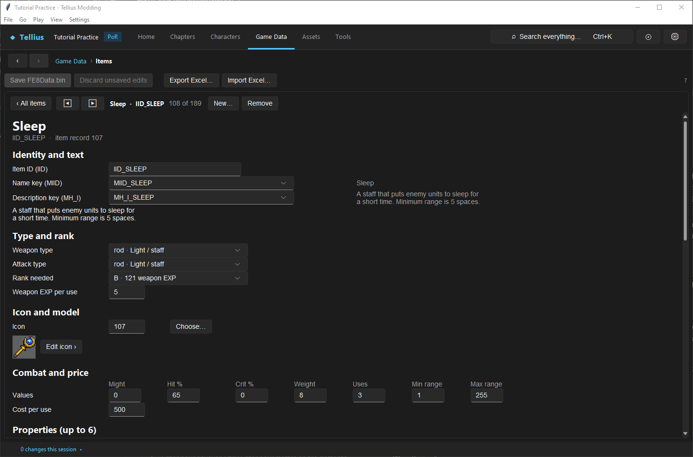
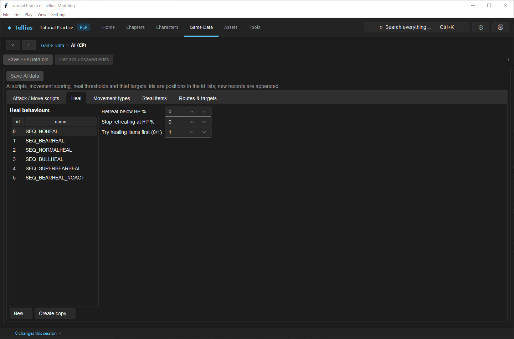

# Tune staves and status effects

**Route:** Game Data → **Items**; Game Data → **AI (CP)** → **Heal**, **Attack / Move scripts**

## What you will make

You will make the Sleep staff more reliable and longer-lasting in uses, read what decides how long a status lasts, and see how enemy healers decide to use staves. At the end you know which staff behaviour you can change in the data, which is fixed in the game code, and which staves do nothing in Path of Radiance.

## Before you begin

- [Create, balance, and present an item or weapon](17-items-and-weapons.md).
- A copy of the project folder.

## How the editor fits together

A staff is an item record (weapon type *rod*). What it **does** is not in its fields: using an item runs the handler registered under its ID (`IID_<name>_UFX`). So:

| You can change in the record | Fixed by the item's ID |
| --- | --- |
| **Rank needed**, **Weapon EXP per use**, **Hit %**, **Uses**, **Min range** / **Max range**, **Cost per use**, icon, name and description, the spell effect (`EID_…`) | Heal amount, cure, status inflicted, warp, rescue, unlock, repair |

A new item with a staff's fields but a new ID has no effect when used. To make a new staff, change an existing one.

Range: a **Max range** of 255 means *Magic / 2*, clamped to 5–15 (Physic, Fortify, Silence, Sleep, Berserk, Rescue).

Statuses are phase counters on the unit ([Combat Mechanics](../systems/combat-mechanics.md)):

| Status | Set by | Starting value | Effect |
| --- | --- | --- | --- |
| Poison | a poisoned weapon | 5 | damage at the start of each own phase |
| Sleep | the Sleep staff, Deadeye | 5 | cannot act |
| Silence | the Silence staff | 5 | cannot use tomes or staves |
| Shock | Stun | 2 | Move is 0 |
| Ward | the Ward staff | 7 | Resistance + the counter (+7, then +6…) |
| Torch | the Torch staff, on the user | 4 | vision in fog + the counter |
| Paralyse | a pit, being shoved | 1 | cannot act until the end of its own phase |

Each side's counters drop by one at the start of its phase. A status staff cast on the enemy phase costs the target four of its own phases. Sleep, Silence and the combat procs always fail against bosses. The starting values are in the game code, not in the item.

**The Berserk staff does nothing in Path of Radiance**: it rolls its hit and plays its animation, but the game has no Berserk counter, so a hit changes nothing. Do not build a chapter around it.

## Guided walkthrough

### 1. Read the Sleep staff

<!-- screenshot 75-a-setup.png -->
<figure class="tutorial-figure" markdown="1">

<figcaption markdown="span">**Game Data › Items**, `IID_SLEEP`: weapon type and attack type *rod* (staff), rank B, **Hit** 65, range 1–255 (255: Magic / 2), 3 uses, weapon EXP 5, the spell effect `EID_SLEEP`. What the staff does belongs to its ID, not to these fields.</figcaption>
</figure>

Open **Game Data › Items**, `IID_SLEEP`: **Weapon type** and **Attack type** *rod · Light / staff*, **Rank needed** *B · 121 weapon EXP*, **Weapon EXP per use** 5, **Hit %** 65, **Uses** 3, **Min range** 1, **Max range** 255, **Cost per use** 500. Its description says *Minimum range is 5 spaces*: the Magic / 2 range never drops under 5.

### 2. Change what the record owns

1. **Hit %** `80`, **Uses** `5`. **Cost per use** stays 500, so the shop price rises with the uses ([Edit armory, vendor, forge, and gold](46-shops.md)).
2. Tab out of the field (Game Data applies a field when it loses focus) and press **Save FE8Data.bin**.
3. Check it in the **Battle Simulator** with a staff user against a non-boss enemy: the forecast hit uses the new 80 ([Simulate and render a fight](56-battle-simulator.md)).

The sleep still lasts 5 phases: that is the game's counter, not this record.

### 3. Read AI healing

<!-- screenshot 75-c-heal.png -->
<figure class="tutorial-figure" markdown="1">

<figcaption markdown="span">**Game Data › AI (CP)**, **Heal**: the retreat rules an AI unit follows to heal itself. `SEQ_NOHEAL` selected: **Retreat below HP %** 0, **Stop retreating at HP %** 0, **Try healing items first (0/1)** 1. Healing others is part of the attack scripts (`use_staff(chance=100)`).</figcaption>
</figure>

1. Open **Game Data › AI (CP)**, **Heal** tab. These records decide when an AI unit retreats to heal itself: **Retreat below HP %**, **Stop retreating at HP %**, **Try healing items first (0/1)**. `SEQ_NOHEAL` never retreats.
2. Healing others is in the attack scripts. On **Attack / Move scripts**, `SEQ_ALLATK100_NOGREIL` starts with `use_staff(chance=100)`: an enemy priest with that script heals before it attacks ([Read and edit AI scripts](43-ai-language.md)).

## Understand every choice

| Field | Effect on a staff |
| --- | --- |
| **Rank needed** | Who can use it (staff rank) |
| **Weapon EXP per use** | Staff experience per use (Heal 3, Sleep 5, Warp 7, Hammerne 8) |
| **Hit %** | Hit of status staves (Sleep 65, Silence 70); healing staves have 100 |
| **Uses** | Uses per staff; shop price = **Cost per use** × **Uses** |
| **Min range** / **Max range** | Fixed range, or 255 for Magic / 2 (5–15) |
| Effect (`EID_…`) | The spell animation; changing it changes the look only |
| Item ID | What the staff does |

## Things to try next

1. **A cheaper Physic.** Lower `IID_REBLOW`'s **Cost per use** and **Rank needed** to D.
2. **Silence versus Sleep.** Compare their hits in the Battle Simulator against a mage and a fighter.
3. **A cautious enemy.** Give an enemy the heal record `SEQ_NORMALHEAL` in its deployment's AI and watch it retreat in [Play and rewind a chapter in the app](58-play-chapter.md).

## Interactions and precedence

- Editing a staff changes every copy in the game, including ones already in a save, except the remaining uses of existing copies.
- The magic-based range reads the user's current Magic, so it changes with level-ups and bonuses.
- Boss immunity covers Sleep, Silence and the combat procs.
- Status counters are saved with the unit: a reloaded unit keeps its remaining phases.

## Test matrix

| Case | Setup | Expected result |
| --- | --- | --- |
| Baseline | `IID_SLEEP` | Hit 65, 3 uses |
| Intended change | Hit 80, 5 uses | Forecast 80 against a non-boss |
| Boundary | Against a boss | Fails whatever the hit (Dolphin) |
| Berserk | Hit with the Berserk staff | Nothing changes (Dolphin) |
| Duration | Sleep cast in enemy phase | Target misses four of its phases (Dolphin) |

## Troubleshooting

| Symptom | Likely cause | What to do |
| --- | --- | --- |
| A new staff does nothing | Its ID has no handler | Edit an existing staff instead |
| Sleep always misses a boss | Boss immunity | Use another plan for bosses |
| A long-range staff reaches 5 tiles with low Magic | The 5-tile minimum of Magic / 2 | Set a fixed **Max range** |
| An enemy healer never heals | Its attack script has no `use_staff` | Give it a healer script |

## Save, build, and revert

Items: **Save FE8Data.bin**. AI records: **Save AI data**. Revert the fields or restore your project copy.

## Limits and confidence

- The record fields, the ID-bound effects, the status table and the Berserk finding come from the engine study ([Items & Weapons](../systems/items-weapons.md), [Combat Mechanics](../systems/combat-mechanics.md), [Status Effects](../systems/status-effects.md)); the records and AI pages were read in the app on a US disc (app-tested).
- The edited staff was not used in Dolphin here (unknown).

## Related tutorials and references

- Before: [Create, balance, and present an item or weapon](17-items-and-weapons.md)
- Also: [Read and edit AI scripts](43-ai-language.md), [Staves](../systems/weapons-staves.md)

---

[← Previous: Make a laguz unit](74-laguz-units.md) · [All tutorials](index.md) · [Next: Edit classes →](16-classes.md)
