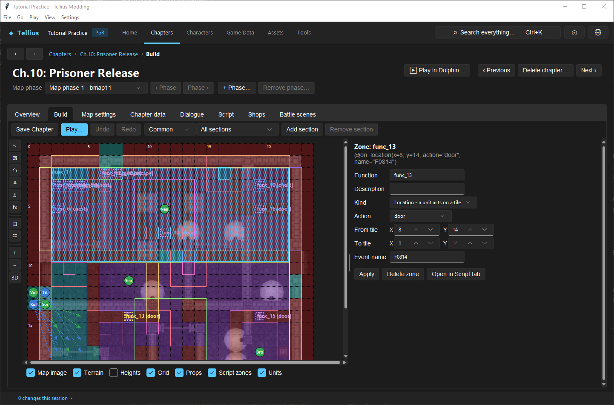
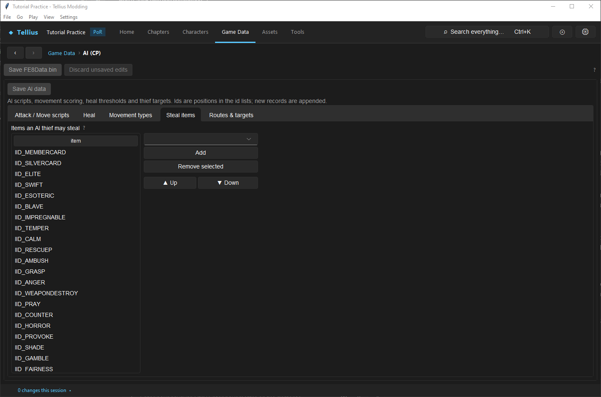

# Add doors, chests and keys

**Route:** a chapter's **Build** (terrain and zones) and **Script**; Game Data → **AI (CP)** → **Steal items**

## What you will make

You will read how Ch.10: Prisoner Release builds its five chests and four doors, then add a chest of your own on Ch.1 that gives a Vulnerary. At the end you know the three pieces every door and chest needs, which units can open them, and how enemy thieves choose what to take.

## Before you begin

- [Paint terrain and control movement](22-paint-terrain-and-blocking.md) and [Place script zones and rolling rocks on the map](66-script-zones-and-rocks.md).
- A copy of the project folder.

## How the editor fits together

A door or a chest is three things that must agree on one tile:

| Piece | Where | Ch.10's chest at (2, 5) |
| --- | --- | --- |
| The terrain type | the map's terrain layer (**Paint terrain**) | *Chest (宝箱)*: makes the *Chest* command appear |
| The event | a *Location* zone, `@on_location(x, y, action="chest" \| "door", name)` | `func_6`, `action="chest"`, `name="宝箱１"` |
| What happens | the event's code | `TBoxOpen(EventGetX(), EventGetY())`, `MindGetItem("IID_COUNTER")`, `set("宝箱１")` |

A door's code is `DoorOpen(EventGetX(), EventGetY())` followed by `set("<name>")`; retail doors also set a story flag for what is behind them (`set("扉セフェラン")`). The visible door or chest is a map prop; the event opens it.

Who can open them:

| Unit | Doors | Chests |
| --- | --- | --- |
| Holding a Door Key (`IID_DOORKEY`) | yes | |
| Holding a Chest Key (`IID_TREASUREKEY`) | | yes |
| A thief with Lockpick (`SID_KEY0`) | yes | yes |
| An enemy | only with **AI uses Door Key** / **AI uses Chest Key** in its deployment flags, or Lockpick | |

AI thieves steal from **Game Data › AI (CP)** › **Steal items**, *Items an AI thief may steal*, in order.

## Guided walkthrough

### 1. Read a chest

<!-- screenshot 76-a-setup.png -->
<figure class="tutorial-figure" markdown="1">

[](../assets/images/tutorials/screenshots/76-a-setup.png)

<figcaption markdown="span">Ch.10 (slot 11), **Build** with **Terrain** and **Script zones**: the chest at (2, 5) selected, `func_6`, *Location - a unit acts on a tile*, **Action** *chest*. Its function opens the chest (`TBoxOpen`), gives the item (`MindGetItem("IID_COUNTER")`) and sets its flag.</figcaption>
</figure>

Open Ch.10: Prisoner Release (slot 11) › **Build**, tick **Terrain** and **Script zones**. Chests and doors are labelled on the map (`func_6 [chest]`, `func_13 [door]`). Click the chest at (2, 5): **Zone: func_6**, *Location - a unit acts on a tile*, **Action** *chest*, **Event name** `宝箱１`. **Open in Script tab** shows its three lines.

### 2. Read a door

<!-- screenshot 76-c-door.png -->
<figure class="tutorial-figure" markdown="1">

[](../assets/images/tutorials/screenshots/76-c-door.png)

<figcaption markdown="span">A door of Ch.10 selected: `func_13`, **Action** *door* at (8, 14). Its function opens it (`DoorOpen`) and sets `F0814`, then a story flag for the cell behind it.</figcaption>
</figure>

Click the door at (8, 14): `func_13`, **Action** *door*, **Event name** `F0814`. Its code: `DoorOpen(EventGetX(), EventGetY())`, `set("F0814")`, `set("扉セフェラン")`.

### 3. Read the tile

<!-- screenshot 76-d-tile.png -->
<figure class="tutorial-figure" markdown="1">

[](../assets/images/tutorials/screenshots/76-d-tile.png)

<figcaption markdown="span">The chest's tile (2, 5) selected: under **Tile (2, 5)** its terrain type, *Chest (宝箱)*, which makes the *Chest* command appear; the zone only says what opening it does.</figcaption>
</figure>

With the select tool, click the chest's tile without its zone (or untick **Script zones**): **Tile (2, 5)** reads *Chest (宝箱)*. Without this terrain type no unit gets the *Chest* command, whatever the script says.

### 4. Add a chest to Ch.1

1. Ch.1 › **Build**: place a chest prop on a free tile, say (5, 3) ([Place, copy, import, and configure props](24-map-props.md)).
2. **Paint terrain** that tile with the chest terrain type of step 3 ([Paint terrain and control movement](22-paint-terrain-and-blocking.md)). **Save Chapter**.
3. Zone tool: **New zone** *Location - a unit acts on a tile*, **Action** *chest*, **Runs** *New function*; click (5, 3).
4. Open the new function in the Script tab and write:

    ```python
    @on_location(x=5, y=3, action="chest", name="TUTORIAL_CHEST")
    def TutorialChest():
        TBoxOpen(EventGetX(), EventGetY())
        MindGetItem("IID_VULNERARY")
        set("TUTORIAL_CHEST")
    ```

    Register `TUTORIAL_CHEST` in `Startup` with `regist(...)`. **Check**, **Save**.
5. Give a player unit a Chest Key (`IID_TREASUREKEY`) in its deployment, and test in Dolphin.

### 5. Thieves

<!-- screenshot 76-b-result.png -->
<figure class="tutorial-figure" markdown="1">

[](../assets/images/tutorials/screenshots/76-b-result.png)

<figcaption markdown="span">**Game Data › AI (CP)**, **Steal items**: *Items an AI thief may steal*, in order, with **Add**, **Remove selected**, **▲ Up**, **▼ Down**. Keys are set per unit: the deployment flags **AI uses Door Key** and **AI uses Chest Key**; thieves with Lockpick (`SID_KEY0`) open both without them.</figcaption>
</figure>

**Game Data › AI (CP)** › **Steal items**: the list of items an AI thief may steal (skill scrolls, the Member Card…), with **Add**, **Remove selected**, **▲ Up** and **▼ Down**. An enemy thief with Lockpick also opens chests; give it the AI that targets them ([Create common AI orders](44-common-ai-orders.md)).

## Understand every choice

| Choice | Effect |
| --- | --- |
| Terrain type *Chest* / door | The command appears on that tile |
| `action="chest"` / `"door"` | The event runs when a unit takes that command there |
| `name=` and `set(name)` | One-time: the chest stays opened, the door open |
| `TBoxOpen` / `DoorOpen` | Plays the open animation and changes the tile |
| `MindGetItem("IID_…")` | Gives the item to the unit that opened the chest |
| Deployment flags **AI uses Door Key** / **AI uses Chest Key** | Let an AI unit use the key it carries |
| **Steal items** | What AI thieves may take, in order |

## Things to try next

1. **A locked room.** Add a door in front of a room with a reinforcement inside, and set a flag in the door's event that triggers the wave ([Add and verify a reinforcement wave](32-reinforcements.md)).
2. **An enemy that opens doors.** Give an enemy a Door Key and tick **AI uses Door Key**.
3. **A chest for one difficulty.** Wrap `MindGetItem` in `if Normal():` as Ch.21's doors do, and give another item otherwise.

## Interactions and precedence

- The terrain, the prop and the event are three separate edits; each one alone does nothing visible in play.
- A chest's item is in the script, not in the map or the deployment.
- Removing a door event leaves a door no one can open.
- The Unlock staff (`IID_UNLOCK`) is in the item table but has no name or description text in the US game; what it opens is not documented here.

## Test matrix

| Case | Setup | Expected result |
| --- | --- | --- |
| Baseline | Ch.10 | Five chests, four doors, labelled on **Build** |
| Intended change | Ch.1 chest at (5, 3) with a Vulnerary | *Chest* command with a Chest Key; Vulnerary given once (Dolphin) |
| Boundary | No chest terrain on the tile | No *Chest* command |
| Thief | Enemy thief with Lockpick next to a chest | Opens it on its phase (Dolphin) |

## Troubleshooting

| Symptom | Likely cause | What to do |
| --- | --- | --- |
| No *Chest* or *Door* command | The tile's terrain type is not a chest or door | Paint it |
| The command opens nothing | No event at that tile, or wrong `action` | Read the zone on **Build** |
| The chest gives its item twice | No `set(name)` | Add it |
| An enemy never opens a door | No key flag or Lockpick | Tick the flag and give the key |

## Save, build, and revert

Terrain and props: **Save Chapter**. Events: **Save** on the Script tab. AI lists: **Save AI data**.

## Limits and confidence

- The three-piece pattern and the calls are read from retail Ch.10 and its neighbours; the key rules come from the deployment flags and the skill and item records (source-reviewed). Ch.10's pieces were read in the app on a US disc (app-tested).
- The new Ch.1 chest was not played in Dolphin here (unknown).

## Related tutorials and references

- Before: [Paint terrain and control movement](22-paint-terrain-and-blocking.md), [Place script zones and rolling rocks on the map](66-script-zones-and-rocks.md)
- Also: [Script Functions](../systems/script-functions.md)

---

[← Previous: Place props, objects, and footprints](24-map-props.md) · [All tutorials](index.md) · [Next: Shape heights and blocking →](23-tile-heights.md)
