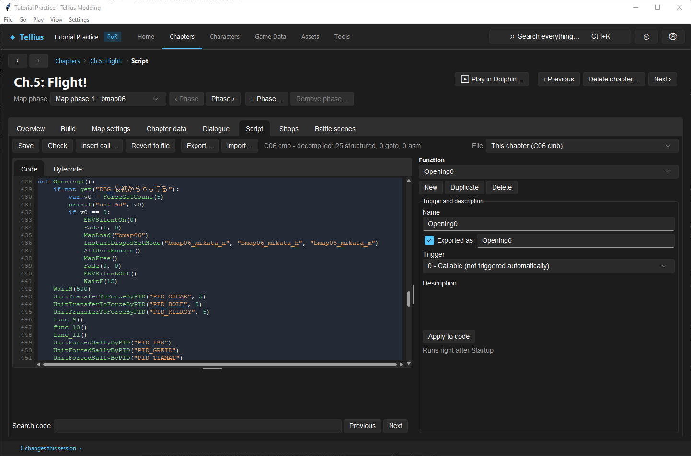
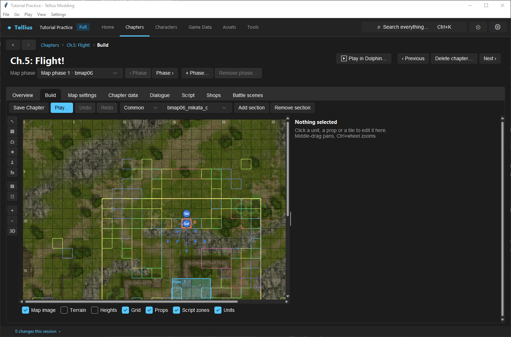
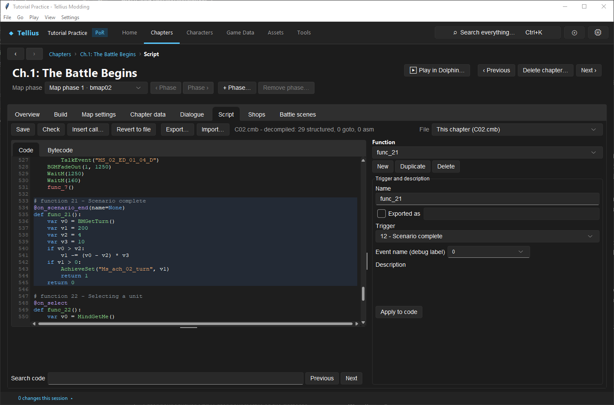

# Set deployment slots, forced units and bonus EXP

**Route:** a chapter's **Build** (the player section) and **Script** (`Opening0`, `RestoreSallyDisposition`, `@on_scenario_end`)

## What you will make

You will read how Ch.5: Flight! sets its preparations (which units must deploy, which tile is locked, where the slots are) and how Ch.1 awards its turn bonus. Then you will make Boyd mandatory in Ch.1 and change its bonus. At the end you know which script calls and which deployment section own each part of the preparation screen and of the bonus EXP results.

## Before you begin

- [Design and connect deployment sections](29-deployment-sections.md) and [Edit, compile, and test event scripts](33-script-editor.md).
- A copy of the project folder.

## How the editor fits together

| Part of the preparations | Owner | Ch.5 |
| --- | --- | --- |
| Deployment tiles (and so how many units) | A player section, made the preparation's group by `SallySetByGroup(group)` (or `SallySetByPos` / `SallyAddByPos` tile by tile) | `RestoreSallyDisposition()` calls `SallySetByGroup("bmap06_mikata_c")`, 8 records |
| Who starts in them | The difficulty's player section, placed in the opening | `InstantDisposSetMode("bmap06_mikata_n", "_h", "_m")` |
| Mandatory units | `UnitForcedSallyByPID(pid)`: the player cannot remove the unit | Ike, Greil, Titania, Oscar, Boyd, Shinon, Gatrie, Rhys, Soren |
| Locked tile | `UnitDontMoveSallyByPID(pid)`: mandatory and its tile cannot be swapped | Ike |

`SallyGetSurplus()` reads how many selected units were left over when the selection finished. The preparation screen then lets the player trade, equip and save; **Battle Start** checks the roster and starts turn 1 ([Battle Preparations](../systems/battle-preparations.md)).

Bonus EXP is written by the chapter's scenario-end functions (trigger *12 - Scenario complete*, `@on_scenario_end`), which the game runs at the end of the chapter. Each function that records an award calls `AchieveSet(message_id, amount)`: one line of the results screen, a label and an amount, added to the party's bonus EXP pool ([Bonus Experience](../systems/bonus-experience.md)).

## Guided walkthrough

### 1. Read the forced units

<!-- screenshot 77-a-setup.png -->
<figure class="tutorial-figure" markdown="1">

[](../assets/images/tutorials/screenshots/77-a-setup.png)

<figcaption markdown="span">Ch.5's `Opening0` on the **Script** tab: `UnitForcedSallyByPID("PID_IKE")` and the other `UnitForcedSallyByPID` lines make units mandatory in the preparations; `UnitDontMoveSallyByPID("PID_IKE")` also locks Ike's starting tile.</figcaption>
</figure>

Open Ch.5: Flight! › **Script**, function `Opening0` (*Runs right after Startup*). After the opening scene, nine `UnitForcedSallyByPID` lines name the units the player must deploy, and `UnitDontMoveSallyByPID("PID_IKE")` also locks Ike's tile.

### 2. Read the slots

<!-- screenshot 77-c-slots.png -->
<figure class="tutorial-figure" markdown="1">

[](../assets/images/tutorials/screenshots/77-c-slots.png)

<figcaption markdown="span">**Build**, *Common* file, section `bmap06_mikata_c` only: 8 records, Ike, Gatrie, Soren, Boyd, Rhys, Titania, Oscar and Shinon, each appearing at (16, 9) and walking to its own tile (arrows). `RestoreSallyDisposition` calls `SallySetByGroup("bmap06_mikata_c")`: the preparation screen takes its deployment tiles from this group.</figcaption>
</figure>

1. In **Function**, pick `RestoreSallyDisposition`: `SallySetByGroup("bmap06_mikata_c")`.
2. Open **Build**, deployment file *Common*, and pick `bmap06_mikata_c` in the section list: 8 records (Ike, Gatrie, Soren, Boyd, Rhys, Titania, Oscar, Shinon), each appearing at (16, 9) and walking to its own tile. The preparation screen takes its deployment tiles from this group.

To allow one more unit, add a record to that section on **Build** ([Design and connect deployment sections](29-deployment-sections.md)); to allow fewer, remove one. **Save Chapter**.

### 3. Read the bonus EXP

<!-- screenshot 77-b-result.png -->
<figure class="tutorial-figure" markdown="1">

[](../assets/images/tutorials/screenshots/77-b-result.png)

<figcaption markdown="span">Ch.1's `func_21`, `@on_scenario_end`: the turn bonus. 200 bonus EXP, minus 10 per turn after turn 4, recorded with `AchieveSet("Ms_ach_02_turn", v1)` as one line of the chapter's bonus results.</figcaption>
</figure>

Open Ch.1 › **Script**, `func_21` (*12 - Scenario complete*):

```python
@on_scenario_end(name=None)
def func_21():
    var v0 = BMGetTurn()
    var v1 = 200
    var v2 = 4
    var v3 = 10
    if v0 > v2:
        v1 -= (v0 - v2) * v3
    if v1 > 0:
        AchieveSet("Ms_ach_02_turn", v1)
        return 1
    return 0
```

200 bonus EXP, minus 10 for each turn after turn 4: 10 on turn 23, nothing from turn 24. `Ms_ach_02_turn` is the label shown on the results screen.

### 4. Change them

1. In Ch.1's `Opening0`, at its end, add `UnitForcedSallyByPID("PID_BOLE")`. **Check**, **Save**.
2. In `func_21`, set `v1 = 300` and `v2 = 6`: 300 bonus EXP, full until turn 6. **Check**, **Save**.
3. For a second award, add another `@on_scenario_end` function, for example one that gives 100 when Boyd survives:

    ```python
    @on_scenario_end(name=None)
    def BoydAlive():
        if UnitCheckLiveByPID("PID_BOLE"):
            AchieveSet("Ms_ach_02_turn", 100)
            return 1
        return 0
    ```

    The label reuses an existing message; make your own in `Mess/common.m` for a real mod.

## Understand every control

| Call or trigger | Effect |
| --- | --- |
| `SallySetByGroup(group)` | The preparation's deployment tiles come from that section |
| `SallyAddByGroup(group)` | Adds a section's tiles to them |
| `SallySetByPos(x, y)` / `SallyAddByPos(x, y)` | Sets or adds one tile |
| `SallyGetSurplus()` | Selected units left over when the selection ended |
| `UnitForcedSallyByPID(pid)` | Mandatory: cannot be removed from the deployment |
| `UnitDontMoveSallyByPID(pid)` | Mandatory and its tile is locked |
| `@on_scenario_end` (*12 - Scenario complete*) | Runs at the end of the chapter |
| `AchieveSet(message_id, amount)` | One bonus line: label and amount |
| `BMGetTurn()` | The turn the chapter ended on |

## Things to try next

1. **A small army.** Remove three records from Ch.1's player section and check that the preparation offers fewer slots.
2. **A bonus for a recruit.** Award bonus EXP when `UnitCheckExistsByPID("PID_TUTORIAL_GUARD")` after [Recruit by talk and make a boss](14-recruitment-and-bosses.md).
3. **No bonus.** Make `func_21` return 0 always, and read the results screen.

## Interactions and precedence

- `UnitForcedSallyByPID` acts on a deployed unit: call it after the player section is placed, as `Opening0` does.
- The opening deploys the difficulty's player section; the preparation uses the group `SallySetByGroup` names. Keep the two consistent.
- Each `@on_scenario_end` function that returns 1 fills the next results line; the results show the lines in the order the functions run.
- Bonus EXP goes to the shared pool, spent at the base; it is separate from battle EXP.

## Test matrix

| Case | Setup | Expected result |
| --- | --- | --- |
| Baseline | Ch.1 | 200 bonus EXP if won by turn 4 (Dolphin) |
| Intended change | `v1 = 300`, `v2 = 6` | 300 if won by turn 6 |
| Forced unit | `UnitForcedSallyByPID("PID_BOLE")` | Boyd cannot be removed in the preparations |
| Slots | One record removed from the player section | One slot fewer |

## Troubleshooting

| Symptom | Likely cause | What to do |
| --- | --- | --- |
| No preparation screen | The chapter does not open one | Copy a chapter that has one |
| A forced unit is missing | Dead, or not in the army yet | Recruit it before this chapter |
| The bonus line never shows | The function returns 0, or its trigger is not *12* | Read the function on the Script tab |
| Wrong number of slots | The group named by `SallySetByGroup` is another section | Compare the name with **Build** |

## Save, build, and revert

Scripts: **Save** on the Script tab. Sections: **Save Chapter**. Revert with **Revert to file** or your project copy.

## Limits and confidence

- The calls, triggers and retail examples are read from the scripts and the function reference (source-reviewed); the Ch.5 and Ch.1 pieces were read in the app on a US disc (app-tested).
- Which coordinate of a player record the preparation uses, and the edited bonus in play, are not checked here (unknown).

## Related tutorials and references

- Before: [Design and connect deployment sections](29-deployment-sections.md)
- Reference: [Battle Preparations](../systems/battle-preparations.md), [Bonus Experience](../systems/bonus-experience.md), [Script Functions](../systems/script-functions.md)

---

[← Previous: Manage chapter parts and phases](65-chapter-parts-and-phases.md) · [All tutorials](index.md) · [Next: Create a campaign skeleton →](08-new-campaign-wizard.md)
