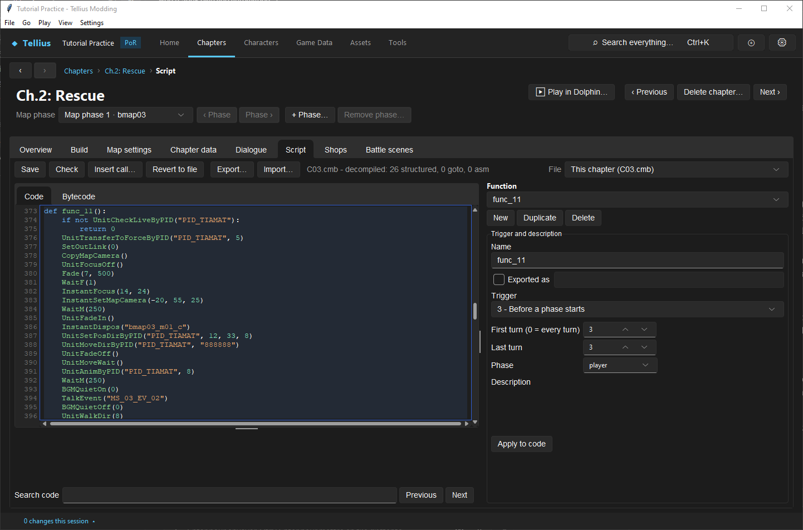
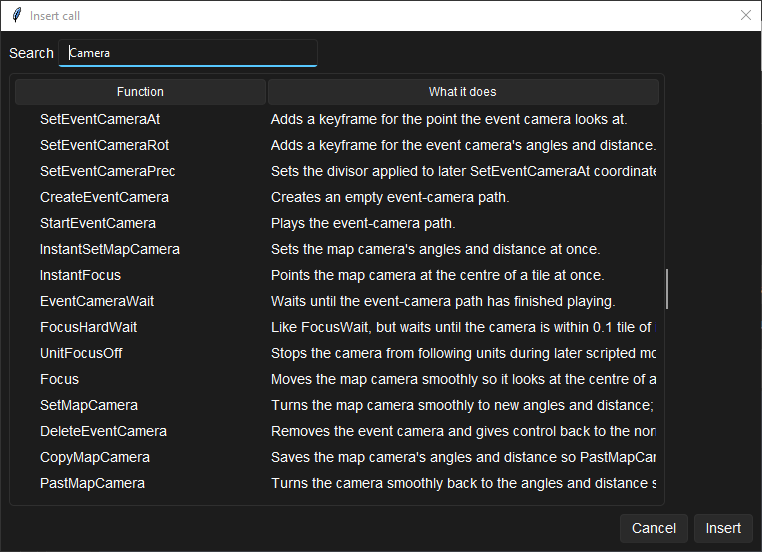

# Script a map cutscene

**Route:** a chapter's **Script** → a function → **Insert call…**

## What you will make

You will read Ch.2's turn-3 scene, where Titania rides onto the map, line by line, then write a short scene for Ch.1 in which the Guard walks in from the map's edge, says one line, and the camera returns to the player. At the end you know the camera, fade, unit and wait calls a map scene is made of, and the order they must come in so the scene also works when the player skips it.

## Before you begin

- [Edit, compile, and test event scripts](33-script-editor.md) and [Add and verify a reinforcement wave](32-reinforcements.md).
- `PID_TUTORIAL_GUARD` with its own name ([Create a character](10-create-character.md)).

## How the editor fits together

A map scene is an event function: everything happens on the map with the map's own models, unlike a movie ([Set chapter title cards and full-screen movies](41-chapter-opening-movies.md)). It is made of five kinds of call ([Script Functions](../systems/script-functions.md)):

| Kind | Calls | What they do |
| --- | --- | --- |
| Camera | `CopyMapCamera()`, `PastMapCamera()` | Save the view, then turn back to it smoothly |
| | `InstantFocus(x, y)`, `Focus(x, y)` | Look at a tile at once / smoothly |
| | `InstantSetMapCamera(yaw, pitch, distance)`, `SetMapCamera(…)` | Set the angles and distance at once / smoothly |
| | `UnitFocusOff()` | Stop the camera from following units |
| | `CreateEventCamera()`, `SetEventCameraAt`, `SetEventCameraRot`, `StartEventCamera`, `EventCameraWait`, `DeleteEventCamera` | A keyframed camera path for bigger shots |
| Screen | `Fade(mode, ms)`, `FadeWait()` | 2 fade in from black, 3 fade out to black, 7 captured-screen transition… |
| Units | `InstantDispos(group)`, `Dispos…` | Place a deployment section |
| | `UnitSetPosDirByPID(pid, x, y, direction)` | Put a unit on a tile, facing a direction |
| | `UnitFadeIn()` / `UnitFadeOff()` | Units fade in as they move |
| | `UnitMoveDirByPID(pid, "path")` | Walk a unit, one digit per step: 2 down, 4 left, 6 right, 8 up |
| | `DisposContinue(group)` | Move a placed section to its records' tiles |
| | `UnitMoveWait()` | Wait until every movement has finished |
| Dialogue | `TalkEvent("MS_…")` | Play a message |
| Sound | `BGMQuietOn(0)`, `BGMQuietOff(0)`, `ENVSilentOn(frames)`, `ENVSilentOff()` | Lower the music, silence the ambience |

When the player skips a scene, fades and moves jump to their end, so the state after the scene must not depend on watching it: units placed and moved by the calls, not by waits.

## Guided walkthrough

### 1. Read a retail scene

<!-- screenshot 78-a-setup.png -->
<figure class="tutorial-figure" markdown="1">

[](../assets/images/tutorials/screenshots/78-a-setup.png)

<figcaption markdown="span">Ch.2's `func_11` (*Before a phase starts*, turn 3, player): Titania's arrival. `CopyMapCamera` keeps the view, `Fade` and `InstantFocus` / `InstantSetMapCamera` frame the edge of the map, `InstantDispos` places her section, `UnitMoveDirByPID("PID_TIAMAT", "888888")` walks her six tiles up, then a message and `PastMapCamera` give the view back.</figcaption>
</figure>

Open Ch.2: Rescue › **Script**, `func_11` (*3 - Before a phase starts*, turn 3, player phase):

| Lines | What happens |
| --- | --- |
| `if not UnitCheckLiveByPID("PID_TIAMAT"): return 0` | No scene if Titania is dead |
| `UnitTransferToForceByPID("PID_TIAMAT", 5)` | Puts her in force 5 for the scene (Ch.5's opening does the same with its arrivals) |
| `CopyMapCamera()`, `UnitFocusOff()` | Saves the view; the camera stops following units |
| `Fade(7, 500)`, `WaitF(1)` | Captured-screen transition |
| `InstantFocus(14, 24)`, `InstantSetMapCamera(-20, 55, 25)` | Looks at the south edge |
| `UnitFadeIn()`, `InstantDispos("bmap03_m01_c")` | Places her section; units fade in as they move |
| `UnitSetPosDirByPID("PID_TIAMAT", 12, 33, 8)`, `UnitMoveDirByPID("PID_TIAMAT", "888888")` | Puts her below the map, facing up, and walks her six tiles up |
| `UnitFadeOff()`, `UnitMoveWait()` | Waits for the walk |
| `BGMQuietOn(0)`, `TalkEvent("MS_03_EV_02")`, `BGMQuietOff(0)` | Her line, music lowered |
| `DisposContinue("bmap03_m01_c")`, `UnitMoveWait()` | The rest of her group moves into place |

It ends with `UnitFocusByPID("PID_IKE")`, `PastMapCamera()` and `FocusHardWait()`: the camera returns to Ike and the saved angles before the phase goes on.

### 2. Find a call

<!-- screenshot 78-c-calls.png -->
<figure class="tutorial-figure" markdown="1">

[](../assets/images/tutorials/screenshots/78-c-calls.png)

<figcaption markdown="span">**Insert call…** with *Camera* in **Search**: every camera function with **What it does**; **Insert** writes the selected call at the cursor.</figcaption>
</figure>

In the Script tab, put the cursor where the call goes and press **Insert call…**. Type `Camera` in **Search**: every camera function with **What it does**. Select one and press **Insert**.

### 3. Write a scene for Ch.1

1. Open Ch.1 › **Dialogue**, add `MS_02_TUTORIAL_GUARD` with one line for the Guard, **Save Chapter**.
2. On **Script**, add:

    ```python
    @before_phase(turn_from=2, turn_to=2, phase="player")
    def TutorialGuardArrives():
        CopyMapCamera()
        UnitFocusOff()
        Fade(7, 500)
        WaitF(1)
        InstantFocus(14, 15)
        InstantSetMapCamera(-20, 55, 25)
        UnitFadeIn()
        InstantDispos("bmap02_tutorial_guard_c")
        UnitSetPosDirByPID("PID_TUTORIAL_GUARD", 14, 18, 8)
        UnitMoveDirByPID("PID_TUTORIAL_GUARD", "888")
        UnitFadeOff()
        UnitMoveWait()
        TalkEvent("MS_02_TUTORIAL_GUARD")
        PastMapCamera()
        FocusWait()
    ```

    It needs a Common section `bmap02_tutorial_guard_c` holding the Guard as an ally or player unit ([Design and connect deployment sections](29-deployment-sections.md)). The trigger runs once, on turn 2 only.
3. **Check**, **Save**. Watch it in [Play and rewind a chapter in the app](58-play-chapter.md), then in Dolphin, once watched and once skipped.

## Understand every choice

| Choice | Why | Instead |
| --- | --- | --- |
| `CopyMapCamera` … `PastMapCamera` | The player gets the view they had | `InstantFocus` on a unit at the end |
| `UnitFocusOff` | The camera stays on your shot while units move | Leave it on to follow the walker |
| `Fade(7, 500)` | A cut that hides the camera jump | `Fade(3, …)` then `Fade(2, …)` through black |
| `UnitFadeIn` before placing | The unit appears as it walks in | Place it in view and skip the fade |
| `UnitMoveWait` before the line | The text waits for the walk | Talk during the walk (no wait) |
| A turn-limited trigger | Runs once without a flag | A flag guard for scenes a condition starts |

## Things to try next

1. **A smooth pan.** Replace `InstantFocus` with `Focus(14, 15)` and `FocusWait()`.
2. **A keyframed shot.** Read Ch.2's opening (`CreateEventCamera`, `SetEventCameraRot`, `SetEventCameraAt`, `StartEventCamera(2)`, `EventCameraWait()`) and copy it.
3. **A scene before battle.** Move your scene into the opening function, after the player section is placed.

## Interactions and precedence

- A scene runs inside a phase: AI and the player wait until it returns.
- Skipping jumps fades and moves to their end; the units still end up where the calls put them.
- A unit placed by the scene stays on the map; remove it (`UnitEscape`, or move it away) if it was only for show.
- The camera's view is not saved: after a reload the tactical camera rebuilds its own.

## Test matrix

| Case | Setup | Expected result |
| --- | --- | --- |
| Baseline | Ch.2, turn 3 | Titania rides in, speaks, the view returns (Dolphin) |
| Intended change | Ch.1 scene on turn 2 | The Guard walks three tiles up, speaks, view returns |
| Skip | Skip the scene | The Guard ends on the same tile |
| Boundary | Turn 3 | The scene does not run again |

## Troubleshooting

| Symptom | Likely cause | What to do |
| --- | --- | --- |
| The unit does not appear | Its section is not placed, or the PID is not in it | Check `InstantDispos` and the section on **Build** |
| The text plays before the walk ends | No `UnitMoveWait()` | Add it before `TalkEvent` |
| The camera stays on the scene | No `PastMapCamera()` | Add it at the end |
| The unit walks through walls | `UnitMoveDir` ignores terrain | Plan the path by hand |
| The scene plays every turn | The trigger's turn range | Set `turn_from` and `turn_to` to the same turn |

## Save, build, and revert

**Save** on the Script tab, **Save Chapter** on Dialogue and Build. Revert with **Revert to file** or your project copy.

## Limits and confidence

- The calls and the retail scene are read from the scripts and the function reference (source-reviewed); Ch.2's scene and the call list were read in the app on a US disc (app-tested).
- The new Ch.1 scene was not watched in Dolphin here (unknown).

## Related tutorials and references

- Before: [Add and verify a reinforcement wave](32-reinforcements.md)
- Reference: [Map Camera](../systems/map-camera.md), [Script Functions](../systems/script-functions.md)

---

[← Previous: Place script zones and rolling rocks on the map](66-script-zones-and-rocks.md) · [All tutorials](index.md) · [Next: Use chapter and campaign flags →](34-event-flags.md)
