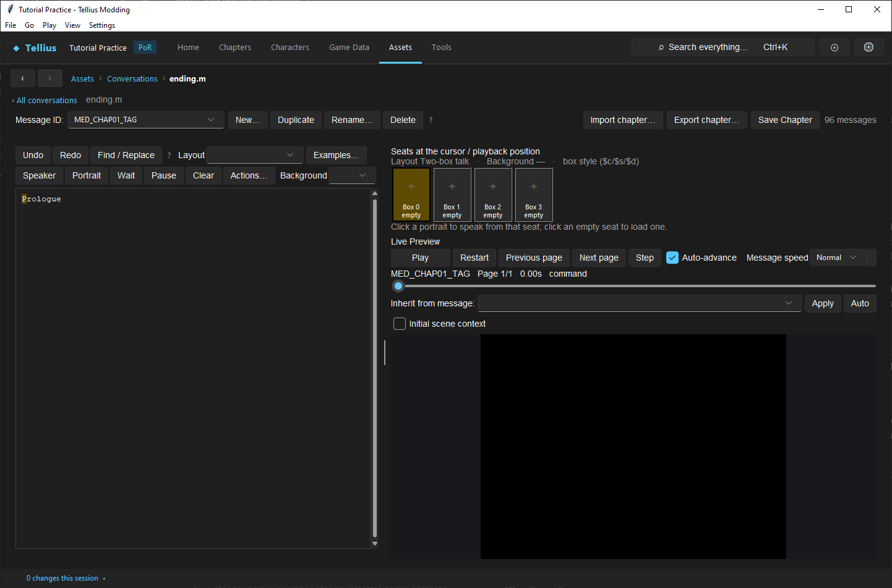
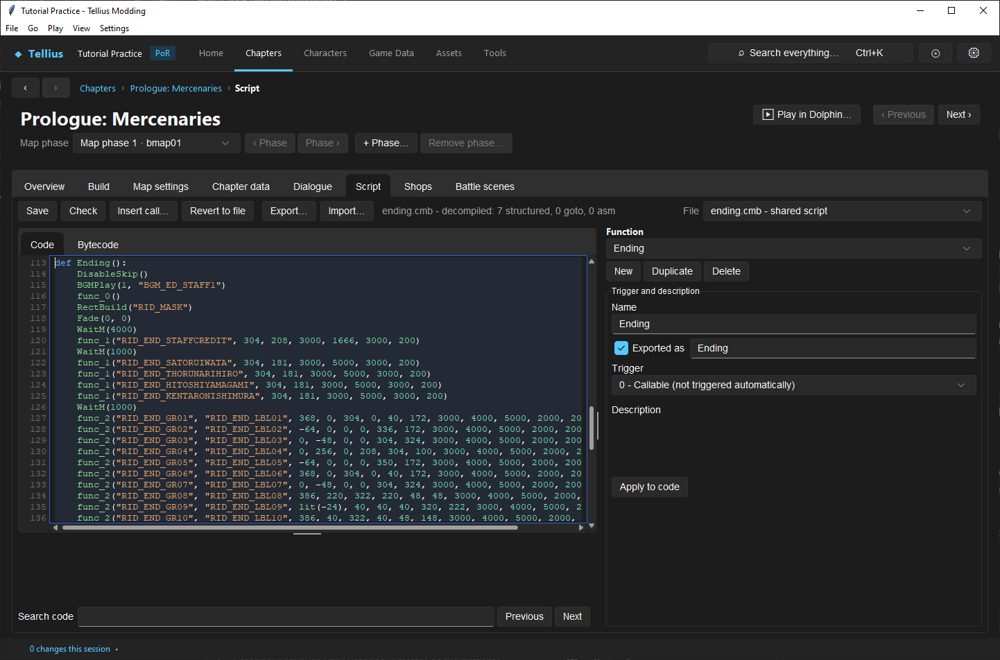
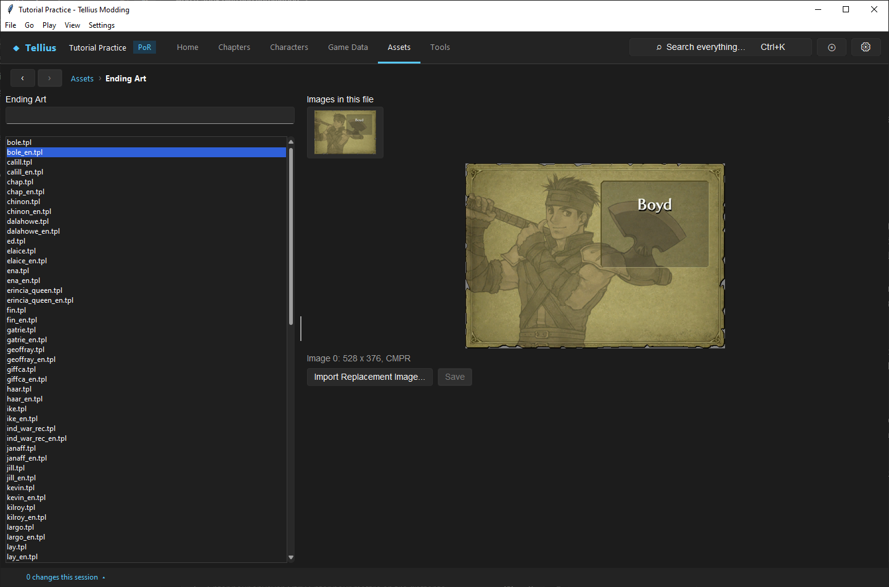

# Edit the ending and the war record

**Route:** Assets → **Conversations** → `ending.m`; a chapter's **Script** → **File** `ending.cmb`; Assets → **Ending Art**

## What you will make

You will rename one chapter in the war record, hold the first artwork of the finale two seconds longer, and replace Boyd's war-record card. At the end you know which file owns each screen after the last battle: the slideshow, the lyrics, the war record and the character cards.

## Before you begin

- [Edit, compile, and test event scripts](33-script-editor.md) and [Lay out screens with Rect RIDs](72-rect-rids.md).
- A copy of the project folder.

## How the editor fits together

After the last chapter, the game runs the `Ending` function of `Scripts/ending.cmb` ([Endgame & Ending Cards](../systems/endings.md)). It shows, in order:

| Screen | Called in `Ending` as | Owner |
| --- | --- | --- |
| Opening credit names | `func_1("RID_END_STAFFCREDIT", x, y, fade-in, hold, fade-out, gap)` | RIDs in `ending/RectFinale_en.bin` |
| 22 artworks with their labels, music `BGM_ED_STAFF1` | `func_2("RID_END_GRnn", "RID_END_LBLnn", …)` | the same rect file |
| Song lyrics over the scrolling staff credits | `BGMPlay(2, "BGM_ED_SONG1")`, `StaffRoll(200000)`, `func_5("RID_END_LYRICnn", …)` | rect file; the credit lines are `ending/staffroll_noa.bin` ([Edit the Sound Room, credits and in-game tutorials](73-sound-room-credits-tutorials.md)) |
| Copyright and *Fin* | `func_3()`, `func_4()` | `RID_END_COPYRIGHT`, `RID_END_FIN_BG`, `RID_END_FIN` |
| War record (chapters, turns) | `WarRecord(15000)` | labels in `Mess/ending.m` |
| Individual war record (one card per unit) | `IndividualWarRecord(15000)` | a card per character, `RID_END_<name>`, in Ending Art |

`func_2`'s fourteen arguments, in order: the artwork's RID, the label's RID, the artwork's start x and y, its end x and y (it slides there while fading in), the label's x and y, then five times in milliseconds (artwork fade-in, label fade-in, hold, fade-out, gap before the next one) and a last value: 1 fades the music out with this artwork (only `RID_END_GR22` has it).

The war record names each chapter by slot: `MED_CHAPnn_TAG` and `MED_CHAPnn_TITLE` for slot `nn` (`MED_CHAP01_TAG` *Prologue*, `MED_CHAP02_TAG` *Chapter 1*), and `MED_DIED_CHAPnn` (*Fell in Chapter 1*) for a unit that died there. `MED_REC_LV`, `MED_REC_WIN` and `MED_REC_TURN` are the column headers *Lv*, *Wins* and *Turns*. Retail has slots 01–31.

## Guided walkthrough

### 1. Read and rename the war-record labels

<!-- screenshot 79-a-setup.png -->
<figure class="tutorial-figure" markdown="1">

[](../assets/images/tutorials/screenshots/79-a-setup.png)

<figcaption markdown="span">**Assets › Conversations**, `ending.m`: the war record's labels. `MED_CHAPnn_TAG` and `MED_CHAPnn_TITLE` name each cleared chapter (*Chapter 1*, *The Battle Begins*), `MED_DIED_CHAPnn` the chapter a unit fell in, `MED_REC_LV`, `_WIN`, `_TURN` the columns.</figcaption>
</figure>

1. Open **Assets › Conversations** and pick `ending.m` (96 messages).
2. In **Message ID**, pick `MED_CHAP02_TITLE`: *The Battle Begins*. Replace the text with `A New Road`.
3. Press **Save Chapter**.

A chapter added with **Add Chapter** gets its three labels written for it ([Assign chapter IDs and story flow](07-chapter-ids-and-story-flow.md)); a chapter you rename later keeps its old ones until you edit them here.

### 2. Read the slideshow

<!-- screenshot 79-c-script.png -->
<figure class="tutorial-figure" markdown="1">

[](../assets/images/tutorials/screenshots/79-c-script.png)

<figcaption markdown="span">`ending.cmb`, function `Ending`, opened in a chapter's **Script** tab through **File**: the finale slideshow. Each `func_2("RID_END_GR01", "RID_END_LBL01", …)` shows one artwork and its label with positions and timings; `func_5("RID_END_LYRIC01", …)` the lyrics.</figcaption>
</figure>

1. Open any chapter's **Script** tab and pick **File** *ending.cmb - shared script*.
2. In **Function**, pick `Ending`. The first artwork:

    ```python
    func_2("RID_END_GR01", "RID_END_LBL01", 368, 0, 304, 0, 40, 172, 3000, 4000, 5000, 2000, 200, 0)
    ```

    The artwork slides from (368, 0) to (304, 0) while it fades in for 3 s; its label appears at (40, 172) over 4 s; both stay 5 s, fade out over 2 s, and the next artwork starts 0.2 s later.

### 3. Hold an artwork longer

1. Change the hold of `RID_END_GR01`, the 11th argument, from `5000` to `7000`.
2. **Check**, **Save**.

The slideshow plays over `BGM_ED_STAFF1`, which `RID_END_GR22` fades out. Each second you add moves every later artwork one second later against the music; keep the total close to retail, or take the time from another artwork.

### 4. Replace a war-record card

<!-- screenshot 79-b-result.png -->
<figure class="tutorial-figure" markdown="1">

[](../assets/images/tutorials/screenshots/79-b-result.png)

<figcaption markdown="span">**Assets › Ending Art**, `bole_en.tpl`: Boyd's war-record card for the English game, his name drawn into the picture. The game shows it as `RID_END_BOLE` and writes his level, wins and the chapter he fell in over it.</figcaption>
</figure>

1. Open **Assets › Ending Art** and pick `bole_en.tpl`: *Image 0: 528 x 376, CMPR*. `bole.tpl` is the Japanese card; the US game uses the `_en` one.
2. Press **Import Replacement Image…** and pick a 528 × 376 PNG with the name drawn in. Press **Save**.

The game finds the card by name: `RID_END_` and the character's PID without `PID_` (`PID_BOLE` → `RID_END_BOLE`). The RID is in `ending/RectFinale_en.bin` ([Lay out screens with Rect RIDs](72-rect-rids.md)).

## Understand every choice

| Choice | Effect | Instead |
| --- | --- | --- |
| Edit `MED_CHAPnn_TITLE` | Renames the chapter in the war record only | The chapter's own title in [Assign chapter IDs and story flow](07-chapter-ids-and-story-flow.md) |
| `func_2` hold | Time an artwork stays fully shown | Fade times change how slowly it appears |
| Last `func_2` argument 1 | The music fades out with that artwork | Leave it on `RID_END_GR22` |
| Replace an `_en` card | Changes the US card | Edit the card without `_en` for the Japanese game |
| Same image size | The rect still draws the whole card | A new size needs the RID's source and destination changed |

## Things to try next

1. **Move a label.** Change `RID_END_LBL01`'s position (the 7th and 8th arguments) and watch where it lands.
2. **A shorter finale.** Delete one `func_2` line (not `RID_END_GR22`'s, which fades the music) the music then fades out sooner, with the last artwork.
3. **A new artwork.** Add an image and RID in `RectFinale_en.bin` ([Lay out screens with Rect RIDs](72-rect-rids.md)) and a `func_2` line for it.

## Interactions and precedence

- The ending runs only after the final chapter: watch it from a save in the last chapter ([Edit a save file](59-save-editor.md)) or with **Play in Dolphin** on the last chapter's page ([Set up Dolphin for testing](04-dolphin-setup.md)).
- `GCST() & 1` skips the fades and moves in `func_1`, `func_2` and `func_5`; the waits still run.
- English and Japanese layouts differ for the lyrics: `func_5` places them by `GetLanguage()`.
- A new character has no card of its own; what the individual war record shows for it was not checked.

## Test matrix

| Case | Setup | Expected result |
| --- | --- | --- |
| Baseline | Retail ending | 22 artworks, lyrics, war record, cards (Dolphin) |
| Intended change | `MED_CHAP02_TITLE` *A New Road* | The war record's second row reads *A New Road* (Dolphin) |
| Timing | `RID_END_GR01` hold 7000 | First artwork stays 2 s longer |
| Card | New `bole_en.tpl` | Boyd's card shows the new image |

## Troubleshooting

| Symptom | Likely cause | What to do |
| --- | --- | --- |
| A chapter row has no name | No `MED_CHAPnn_` labels for its slot | Add them in `ending.m` |
| The music ends before the slideshow | Holds made longer | Shorten others, or move the fade |
| A card is cut or stretched | Its replacement has another size | Use 528 × 376, or edit the RID |
| **Check** fails on `ending.cmb` | A `func_2` line lost an argument | It takes 14 |

## Save, build, and revert

Labels: **Save Chapter** on `ending.m`. Script: **Save** on the Script tab. Cards: **Save** on Ending Art. Revert with **Revert to file**, or your project copy.

## Limits and confidence

- The `Ending` sequence, the labels and the card names are read from `ending.cmb`, `ending.m`, `RectFinale_en.bin` and the war-record code of `main.dol` (source-reviewed); the three files were opened in the app on a US disc (app-tested).
- The edited ending was not watched in Dolphin here (unknown).

## Related tutorials and references

- Before: [Lay out screens with Rect RIDs](72-rect-rids.md)
- Also: [Edit shared startup helpers and endings](36-shared-scripts.md), [Edit the Sound Room, credits and in-game tutorials](73-sound-room-credits-tutorials.md)
- Reference: [Endgame & Ending Cards](../systems/endings.md)

---

[← Previous: Set chapter title cards and movies](41-chapter-opening-movies.md) · [All tutorials](index.md) · [Next: Import a translation font →](42-font-translation.md)
