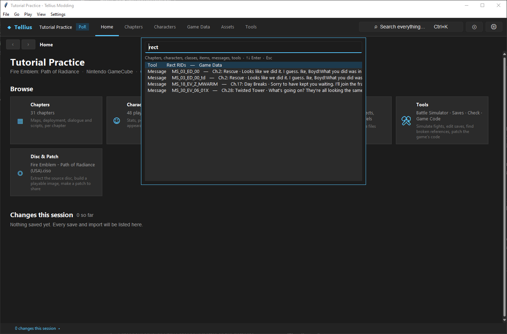
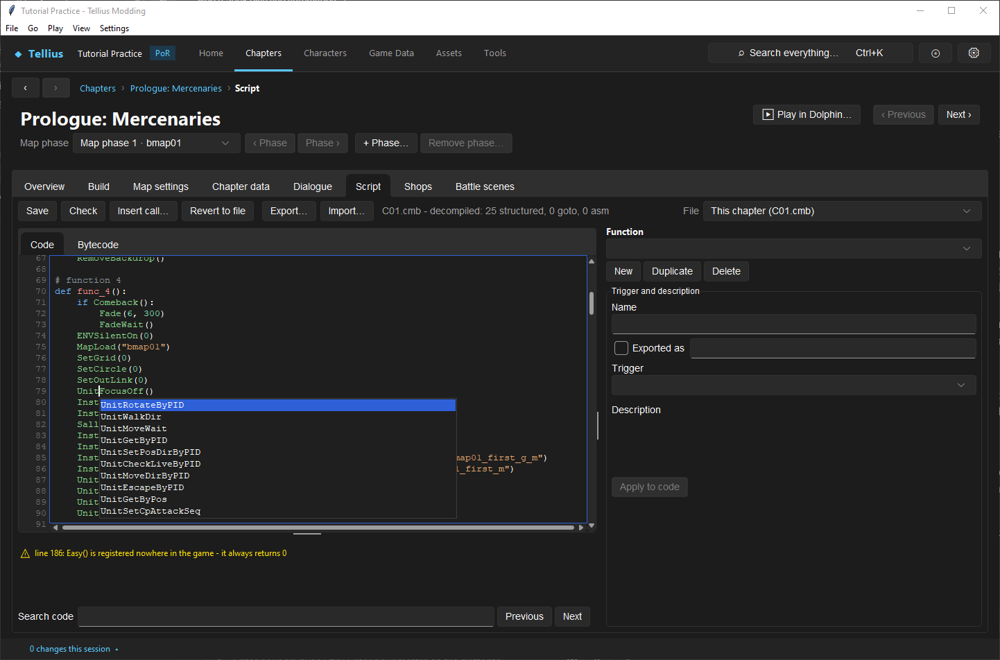
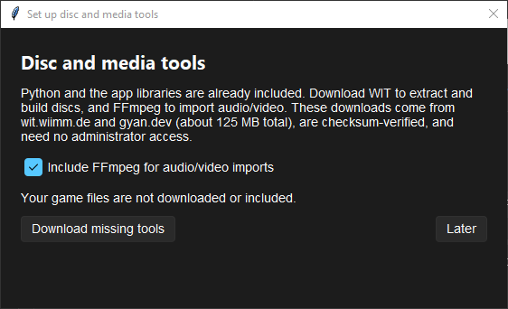

# Use menus, shortcuts and preferences

**Route:** the menu bar (**File**, **Go**, **Play**, **View**, **Settings**); **Ctrl+K** anywhere

## What you will make

You will open a Game Data tab from the search palette, complete a script call with the keyboard, and check which tools and programs the app uses. At the end you know every menu entry, every shortcut and where the app keeps its preferences.

## Before you begin

- [Tour the workspace](02-workspace-tour.md).
- A project open in the app. Nothing in this lesson changes the project.

## How the editor fits together

The menu bar:

| Menu | Entry | What it does |
| --- | --- | --- |
| **File** | **New Project...** / **Open Project...** | Make a project from a disc image / open a project folder ([Install the app and create a project](01-install-create-project.md)) |
| | **Close Project** | Back to the start screen; asks about unsaved edits |
| | **Apply patch to a disc...** | Apply a patch file to a clean disc, without a project ([Share a patch](61-share-a-patch.md)) |
| | **Exit** | Close the app |
| **Go** | **Home**, **Chapters**, **Characters**, **Game Data**, **Assets**, **Tools** | The six sections of the top bar |
| | **Search...** (Ctrl+K), **Back** (Alt+Left), **Forward** (Alt+Right) | The palette and the page history |
| **Play** | **Play chapter in Dolphin...** (F5) | Boot the extracted files into a chapter ([Set up Dolphin and build the game](04-dolphin-setup.md)) |
| | **Build and play disc in Dolphin** (Ctrl+F5) | Build the disc image, then start it |
| **View** | **Changes this session** | The list of saves and imports of this session, above the status bar ([Save changes and restore originals](03-saving-and-restoring.md)) |
| **Settings** | **Preferences...** | Theme, Dolphin and Blender locations, the Blender terrain add-on |
| | **Disc and media tools...** | Download WIT and FFmpeg |

On the top bar, the 💿 button opens **Disc & Patch** and ⚙ opens **Preferences**.

Shortcuts:

| Where | Key | Effect |
| --- | --- | --- |
| Main window | **Ctrl+K** | Search palette (not inside a text box, where Ctrl+K belongs to the box) |
| | **F5** / **Ctrl+F5** | Play a chapter / build and play |
| | **Alt+Left** / **Alt+Right** | Back / Forward |
| Search palette | **↑** **↓**, **Enter**, **Esc** | Pick, open, close |
| Script tab | **Ctrl+Space** | Completion list for the word before the cursor (it also opens as you type) |
| | **Enter** or **Tab** in the list, **Esc** | Put the call in / close the list |
| | **Ctrl+F**, **F3**, **Shift+F3** | **Search code**, next match, previous match |
| Dialogue tab | **Ctrl+F** or **Ctrl+H**, **Ctrl+S** | **Find / Replace**, save |
| Build tab map | **Delete**, **R**, **Esc** | Delete the selection, rotate it, deselect |
| | **Ctrl+Z** / **Ctrl+Y**, **Ctrl+wheel** | Undo / redo, zoom |
| Record forms (Game Data, Stats) | **Enter** (**Ctrl+Enter** in a multi-line box) | Apply the field now; leaving the field also applies it |
| Most dialogs | **Esc** | Close |

## Guided walkthrough

### 1. Open a tab from the search palette

<!-- screenshot 80-a-setup.png -->
<figure class="tutorial-figure" markdown="1">

<figcaption markdown="span">**Ctrl+K** with *rect*: tools come first (*Tool · Rect RIDs*), then every record whose name, ID or text holds the word. **↑**/**↓** pick, **Enter** opens, **Esc** closes.</figcaption>
</figure>

1. Press **Ctrl+K** and type `rect`. The first line is *Tool · Rect RIDs — Game Data*; below it, messages whose ID or text holds *rect*.
2. Press **Enter**: **Game Data › Rect RIDs** opens.
3. Press **Alt+Left** to go back.

The palette finds the sections, every Game Data tab, the asset pages and tools, chapters, characters, classes, items, skills and messages. Several words narrow the list to entries holding all of them: `rescue boyd` finds the Ch.2: Rescue messages that mention Boyd.

### 2. Complete a call in a script

<!-- screenshot 80-c-complete.png -->
<figure class="tutorial-figure" markdown="1">

<figcaption markdown="span">Script tab, **Ctrl+Space** after `Unit`: every script function starting with it, with its arguments; **Enter** or a double-click inserts the selected one.</figcaption>
</figure>

1. Open Prologue: Mercenaries › **Script**. Click at the end of an empty line and type `Unit`: the list opens under the cursor.
2. Press **↓** to `UnitMoveWait`, then **Enter**. Type `(`: the call's arguments show in the line under the code.
3. Press **Revert to file** to throw the line away.

### 3. Check the tools

<!-- screenshot 80-b-result.png -->
<figure class="tutorial-figure" markdown="1">

<figcaption markdown="span">**Settings › Disc and media tools…**: downloads WIT (extract and build discs) and, with **Include FFmpeg for audio/video imports**, FFmpeg. **Later** closes without downloading.</figcaption>
</figure>

1. **Settings › Disc and media tools...**: WIT extracts and builds discs, FFmpeg imports audio and video ([Replace or add music](47-music.md), [Replace a video and manage disc size](49-videos.md)). **Download missing tools** fetches only what is missing (about 125 MB for both, checksum-verified). Press **Later**.
2. **Settings › Preferences...**: **Theme** *Dark* or *Light*; **Dolphin location (Dolphin.exe)** and **Blender location (blender.exe)**, empty to search the usual folders; **Install the Tellius Terrain add-on**, which adds a terrain sculpt and paint panel (3D View sidebar, *Tellius* tab) to Blender. Press **Close**.

## Understand every control

| Control | Effect | Kept in |
| --- | --- | --- |
| **Theme** | Dark or light, at once | `settings.json` |
| **Dolphin location** | The emulator **Play** starts | `settings.json` |
| **Blender location** | Used for `.blend` export and the terrain add-on | `settings.json` |
| Recent projects | The start screen's list | `recent_projects.json`, same folder |
| **Changes this session** | This session's saves, not kept | memory only |

The preferences live in `.tellius_modding/settings.json` in your user folder, apart from every project: a new project uses the same Dolphin and Blender, and deleting a project does not lose them.

## Things to try next

1. **Search a message.** Type a word of a line of dialogue in the palette and open it in its chapter's **Dialogue** tab.
2. **Light theme.** Switch **Theme** in **Preferences** and back.
3. **Find a function.** In a long script, **Ctrl+F**, type `TalkEvent`, then **F3** through each match.

## Interactions and precedence

- Ctrl+K inside a script or dialogue text box stays with the box.
- The palette searches the project index: right after opening a project, chapters, characters and messages appear once the index is built.
- **Play** uses the saved files: save before F5 ([Save changes and restore originals](03-saving-and-restoring.md)).
- Form fields apply when you press **Enter** or leave them; the page's **Save** button writes the file.

## Test matrix

| Case | Setup | Expected result |
| --- | --- | --- |
| Baseline | **Ctrl+K**, `rect` | *Tool · Rect RIDs* first |
| Intended change | **Enter** on it | **Game Data › Rect RIDs** opens |
| Completion | `Unit` + **Ctrl+Space** in a script | The list of `Unit…` functions |
| Boundary | **Ctrl+K** inside the script text | No palette |

## Troubleshooting

| Symptom | Likely cause | What to do |
| --- | --- | --- |
| Ctrl+K does nothing | The cursor is in a text box, or no project is open | Click outside the box |
| The palette finds no character | The index is still building | Wait for the status bar |
| F5 says Dolphin was not found | Empty or wrong **Dolphin location** | Set it in **Preferences** |
| Music import asks for FFmpeg | FFmpeg not downloaded | **Disc and media tools...** with the FFmpeg box ticked |

## Save, build, and revert

The preferences save when you leave a field or press **Browse…**. Nothing in this lesson changes the project; **Revert to file** throws away the completed call of step 2.

## Limits and confidence

- The menus, shortcuts and preferences are read from the app's source and were used in the app on a US project (source-reviewed, app-tested).

## Related tutorials and references

- Before: [Tour the workspace](02-workspace-tour.md)
- Also: [Find where a record is used](68-find-references.md), [Set up Dolphin and build the game](04-dolphin-setup.md)

---

[← Previous: Find where a record is used](68-find-references.md) · [All tutorials](index.md) · [Next: Understand a chapter's parts →](06-chapter-anatomy.md)
